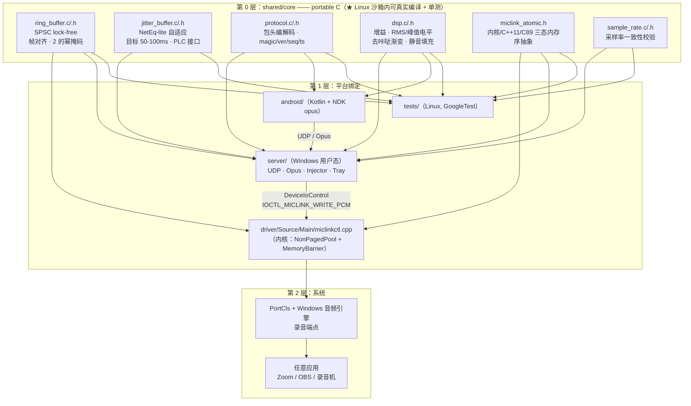
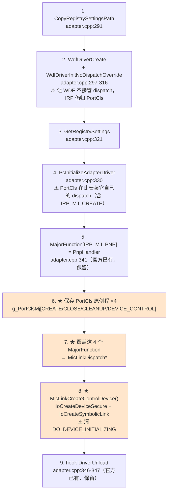
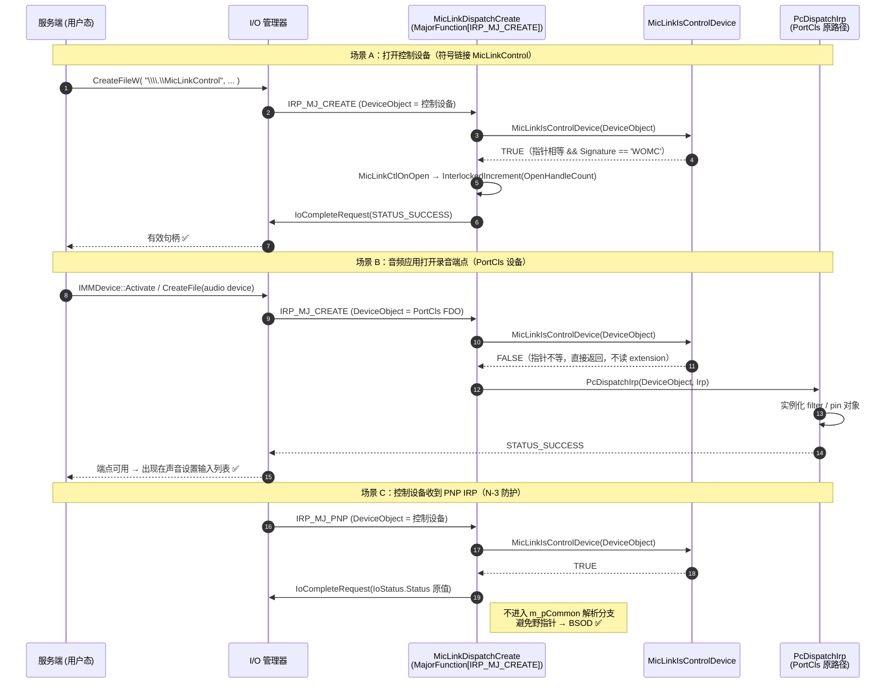
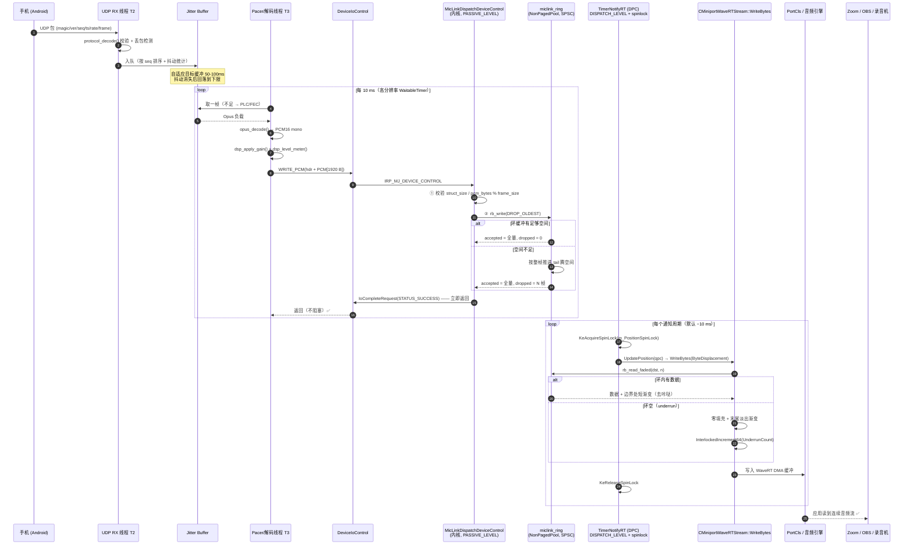
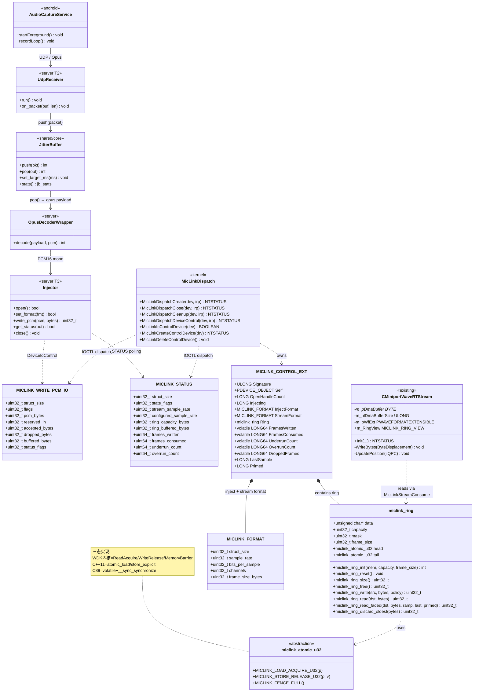
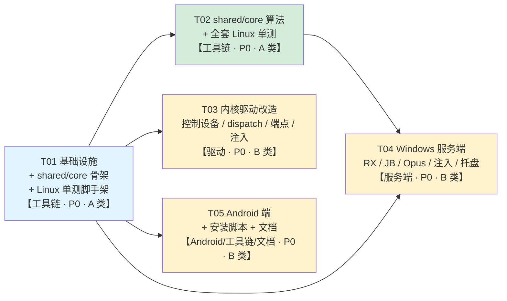

# miclink-open 系统架构设计

> 版本 v1.0 ｜ 架构师：高见远 ｜ 语言：中文
> 上游输入：`docs/PRD.md` v1.0（许清楚）
> 驱动基线：`microsoft/Windows-driver-samples` @ `2dc3fd3a0cc84a2933f2194e7ec0871584979071`，路径 `audio/simpleaudiosimple`（46 文件 / 612 KB）
>
> 本文档中所有行号、函数名、结构体均来自**实际拉取到的源码**，未经二次推测。凡属设计判断（而非源码事实）的地方均已显式标注为「设计决策」。

---

## 0. 源码事实核查与设计影响摘要

### 0.1 上游给定的事实（已核实）

| # | 事实 | 位置 | 核实 |
|---|---|---|---|
| F-1 | `DriverEntry` 主体 | `driver/Source/Main/adapter.cpp:253-367` | ✅ 一致 |
| F-2 | `PcInitializeAdapterDriver(...)` 调用行 | `adapter.cpp:330` | ✅ 一致 |
| F-3 | 官方示例**在 Pc 初始化之后**覆盖 `IRP_MJ_PNP` = `PnpHandler` | `adapter.cpp:341` | ✅ 一致 |
| F-4 | 官方示例 hook PortCls 的 Unload | `adapter.cpp:346-347` | ✅ 一致 |
| F-5 | `WdfDriverCreate` 设置 `WdfDriverInitNoDispatchOverride` | `adapter.cpp:297-316` | ✅ 一致 |
| F-6 | 正弦波注入点：`CMiniportWaveRTStream::WriteBytes` | `minwavertstream.cpp:1392-1421`，调用在 **1416 行** | ✅ 一致 |
| F-7 | ~~`ToneGenerator::Init` 调用~~ | ~~`minwavertstream.cpp:351`~~ | ⛔ **已删除**（基线对照点，现为 `MicLinkStreamBind`，见 §4.5 / D-04） |
| F-8 | ~~ToneGenerator 实现，161 行 `if (m_Mute \|\| g_DisableToneGenerator)`~~ | ~~`driver/Source/Utilities/ToneGenerator.cpp:161`~~ | ⛔ **文件已删除**（D-04） |
| F-9 | `MicArrayPinSupportedDeviceFormats[]` 当前只有 48kHz/32-bit/2ch 一项 | `micarraywavtable.h:29-61` | ✅ 一致 |
| F-10 | 端点配对表 | `Source/Filters/minipairs.h` | ✅ 一致 |
| F-11 | 麦克风拓扑 | `micarraytopo.cpp` + `micarray1toptable.h` | ✅ 一致 |
| F-12 | 扬声器拓扑 | `speakertopo.cpp` + `speakertoptable.h` / `speakerwavtable.h` | ✅ 一致 |
| F-13 | INF 模板（**UTF-16LE 编码**） | `Source/Main/SimpleAudioSample.inx` | ✅ 一致 |
| F-14 | AddDevice / StartDevice / InstallSubdevice | `adapter.cpp:375-429` / `673-772` / `621-669` | ✅ 一致 |

### 0.2 架构师新增发现（**这三条直接改变设计，务必先看**）

| # | 发现 | 位置 | 对设计的影响 |
|---|---|---|---|
| **N-1** | `CMiniportWaveRT::DataRangeIntersection` **硬编码只返回格式表第 [0] 项**：`*resultantFormat = *MicArrayPinSupportedDeviceFormats;` | `minwavert.cpp:226-252`（关键行 248） | ⚠️ **仅往 `MicArrayPinSupportedDeviceFormats[]` 里加一条 44.1k 是不够的**，Windows 永远只会拿到 [0]。必须同时改写 `DataRangeIntersection` 为「遍历匹配」。这是 D3 工作量与风险的主要来源。 |
| **N-2** | `WriteBytes` 的调用者 `UpdatePosition` 运行在 **DISPATCH_LEVEL 且持有 `m_PositionSpinLock`** 自旋锁之下 | `minwavertstream.cpp:1302`（1336 行调用 `WriteBytes`）；调用源：`GetPosition()`(792)、`GetPacketCount()`(1031)、`GetPositions()`(1065)、`TimerNotifyRT()`(1595，自旋锁在 1569 获取，IRQL 注解在 1559) | ⚠️ **驱动侧环形缓冲的消费端（读侧）在 DPC 中、拿锁、高 IRQL 下运行** → 读侧**绝不能**阻塞、分配内存、访问分页内存或获取普通自旋锁。这一条**直接否掉** D5 的「METHOD_IN_DIRECT + pending IRP + DPC 完成」方案。 |
| **N-3** | `PnpHandler` 是为**整个 DriverObject** 注册的 `IRP_MJ_PNP`，它无条件把 `DeviceObject->DeviceExtension` 强转为 `PortClassDeviceContext` 并读 `m_pCommon`（x64 偏移 40） | `adapter.cpp:776-842`（关键行 824-832）；`PortClassDeviceContext` 定义在 `Source/Inc/definitions.h:142-154` | ⚠️ **若我们新建的控制设备收到任何 PNP IRP，`PnpHandler` 会把我们的 device extension 当 PortCls 上下文解析，读到一个野指针并调用 `->Cleanup()`/`->Release()` → 必定 BSOD。** 必须在 `PnpHandler` 入口加控制设备判定并短路返回。这是 D1 的必做项，上游清单里没有。 |
| N-4 | 源码已使用 Win10 2004+ API：`ExAllocatePool2`（`adapter.cpp:157`）、`EX_TIMER`/`ExSetTimer`（`minwavertstream.cpp:1261`） | 见位置 | PRD「兼容性 Win10 1607+」与源码实际依赖冲突，实际下限约为 **Win10 2004 / build 19041**。见 §11-Q7。 |
| N-5 | INF `[Manufacturer]` 目标为 `NT$ARCH$.10.0...22000`（= Windows 11 21H2+），与 PRD「Win10 1607+」不一致 | `SimpleAudioSample.inx:26` | 同上，见 §11-Q7。 |
| N-6 | speaker 的交叉引用面很小且高度收敛 | 见 §3.1 清单 | 支持 D2「移除 speaker」的结论，风险可控。 |

---

## 1. 架构总览

### 1.1 分层图



### 1.2 关键约束回顾（不得推翻）

| # | 约束 | 落地点 |
|---|---|---|
| C-1 | 控制设备对象与音频设备对象分离；`IoCreateDevice` 独立控制设备 + 符号链接；`DriverEntry` 挂 `IRP_MJ_CREATE`/`CLOSE` | §2 |
| C-2 | 必须正确处理 `PcInitializeAdapterDriver` 对 `IRP_MJ_CREATE` 的覆盖 | §2.2, §2.6 |
| C-3 | 至少支持 16-bit/44.1k 与 16-bit/48k 单声道 | §4 |
| C-4 | 写入路径非阻塞或异步 | §5, §6 |
| C-5 | 驱动侧不做重采样，不一致时服务端拒绝启动 | §7.4, §9.3 |
| C-6 | UDP + Opus，禁 TCP/WebSocket 主通道；Jitter Buffer 50–100ms 自适应 | §8, §9.4 |

---

## 2. D1：PortCls dispatch 覆盖的精确设计

### 2.1 需要保存 / 覆盖的 MajorFunction

`PcInitializeAdapterDriver`（`adapter.cpp:330`）会为**整个 DriverObject** 安装一组 dispatch，因此该驱动下**所有**设备对象（含我们新建的控制设备）的 IRP 都会先过这张表。

| MJ index | PortCls 原例程 | 我们是否覆盖 | 非控制设备的处理 |
|---|---|---|---|
| `IRP_MJ_CREATE` (0x00) | ✅ **必须保存** | ✅ 覆盖 | `PcDispatchIrp()` 转发 |
| `IRP_MJ_CLOSE` (0x02) | ✅ **必须保存** | ✅ 覆盖 | `PcDispatchIrp()` 转发 |
| `IRP_MJ_CLEANUP` (0x12) | ✅ **必须保存** | ✅ 覆盖 | `PcDispatchIrp()` 转发 |
| `IRP_MJ_DEVICE_CONTROL` (0x0E) | ✅ **必须保存** | ✅ 覆盖 | `PcDispatchIrp()` 转发 |
| `IRP_MJ_PNP` (0x1B) | 官方已在 341 行覆盖 | ❌ 不动（只补控制设备短路） | `PcDispatchIrp()`（官方已有） |
| `IRP_MJ_POWER` (0x16) | 不覆盖 | ❌ | 原样交给 PortCls |
| `IRP_MJ_SYSTEM_CONTROL` (0x17) | 不覆盖 | ❌ | 原样交给 PortCls |
| `IRP_MJ_SHUTDOWN` / `FLUSH_BUFFERS` | 不覆盖 | ❌ | 原样交给 PortCls |

> **设计决策（保存 vs `PcDispatchIrp`）**：保存原例程**照做**，但**转发路径优先使用 `PcDispatchIrp()`**。
> 理由：① `PcDispatchIrp` 是 PortCls 官方支持的「拦截器回投」API，且**本示例自己就在 `PnpHandler` 里这么用**（`adapter.cpp:839`），口径一致、可维护性最好；② 直接调保存的裸指针隐含依赖未文档化的调用约定与 IRQL 契约，且会跳过 PortCls 对设备对象的合法性校验，跨 WDK 版本脆弱。
> 保存下来的指针定位为**兜底与诊断**：若 bring-up 阶段发现 `PcDispatchIrp` 对某类 PortCls 设备返回非预期值，可在编译期宏 `MICLINK_USE_SAVED_DISPATCH` 切换为直接调用保存指针。这是**预案**，不是二选一的赌注。

### 2.2 DriverEntry 的精确顺序（不可调换）



**为什么必须在第 4 步之后覆盖、且在覆盖之后才建控制设备：**

- 若在 `PcInitializeAdapterDriver` **之前**覆盖：`PcInitializeAdapterDriver` 会**静默覆盖掉我们的 hook**（它直接给 `MajorFunction[IRP_MJ_CREATE]` 赋值），hook 丢失。
- 若**先建控制设备再覆盖**：在覆盖完成前的时间窗内，`CreateFile` 会打到 PortCls 的 create 处理。PortCls 会去解析我们控制设备的 device extension，找不到它的签名——**很多 PortCls create 分支对未知设备仍然返回 SUCCESS**，于是出现「`CreateFile` 成功，但端点枚举被扰动」的诡异现象。

第 5 步（官方已有的 PNP 覆盖）与第 7 步同源同理，这正是官方把这行放在 341 行的原因——**我们的改动是照抄官方已验证的模式，不是新发明**。

### 2.3 控制设备识别：签名 magic + 全局指针（两者结合，职责分离）

**设计决策：用「全局指针快速拒绝 + device extension 签名 magic 最终裁定」的两段式判定。**

```c
/* driver/Source/Inc/miclink/miclink_ctl.h */

/* 4 字节 magic，池 tag 同源命名 */
#define MICLINK_CONTROL_SIGNATURE  0x574F4D43UL   /* 'WOMC' */
#define MICLINK_POOLTAG            'CmoW'         /* 调试器显示为 "WomC" */

#define MICLINK_CONTROL_NT_NAME    L"\\Device\\MicLinkControl"
#define MICLINK_CONTROL_SYMLINK    L"\\DosDevices\\Global\\MicLinkControl"   /* 用户态: \\.\MicLinkControl */

typedef struct _MICLINK_CONTROL_EXT {
    ULONG            Signature;          /* = MICLINK_CONTROL_SIGNATURE，必须第一个字段 */
    PDEVICE_OBJECT   Self;
    PDEVICE_OBJECT   PhysicalDeviceObject;
    LONG             OpenHandleCount;    /* InterlockedIncrement / Decrement */
    LONG             Injecting;          /* InterlockedExchange */

    MICLINK_FORMAT     InjectFormat;       /* SET_FORMAT 设置的注入格式 */
    MICLINK_FORMAT     StreamFormat;       /* 当前打开的 capture 流的实际格式 */
    LONG             StreamOpen;         /* InterlockedExchange */

    /* 内核侧环形缓冲 —— 内存由 NonPagedPool 提供 */
    miclink_ring       Ring;

    /* 统计（只写侧各自独占，读侧用 Interlocked/volatile 读） */
    volatile LONG64  FramesWritten;
    volatile LONG64  FramesConsumed;
    volatile LONG64  UnderrunCount;
    volatile LONG64  OverrunCount;
    volatile LONG64  DroppedFrames;
    volatile ULONG   RingHighWatermark;

    /* 去咔哒状态（消费者独占） */
    LONG             LastSample;
    LONG             Primed;
} MICLINK_CONTROL_EXT, *PMICLINK_CONTROL_EXT;

/* 仅用于生命周期管理（创建/卸载），绝不用于 dispatch 路由 */
extern PDEVICE_OBJECT g_pMicLinkControlDevice;

/* 两段式判定：先指针快拒（不读任何内存），再签名终裁 */
__forceinline BOOLEAN MicLinkIsControlDevice(_In_ PDEVICE_OBJECT DeviceObject)
{
    if (DeviceObject == NULL)                        { return FALSE; }
    if (DeviceObject != g_pMicLinkControlDevice)       { return FALSE; }   /* 快拒：不触碰未知设备的 extension */
    if (DeviceObject->DeviceExtension == NULL)       { return FALSE; }
    return (((PMICLINK_CONTROL_EXT)DeviceObject->DeviceExtension)->Signature
            == MICLINK_CONTROL_SIGNATURE);                                /* 终裁：防野/已释放指针 */
}
```

**论证（为什么是「两者结合」而不是二选一）：**

| 方案 | 优点 | 缺陷 | 结论 |
|---|---|---|---|
| **只用全局指针** `DevObj == g_pCtlDev` | 一行，零成本 | ① **生命周期竞态**：`IoDeleteDevice` 后若仍有在途 IRP 或符号链接上的并发 `CreateFile`，指针比较**仍会命中已释放对象** → UAF → BSOD；要治就得在 dispatch 路径加锁/引用计数，反而更贵。② 无法扩展到多控制设备。③ 每包都读共享全局变量（伪共享）。 | 单独用=不安全 |
| **只用签名 magic** | 无锁、无全局、天然并发安全；与 PortCls 自身的 `PortClassDeviceContext` 同一套路（`definitions.h:142-154`） | 若对象已被释放，读签名同样是 UAF（只是概率低） | 单独用=基本正确但不完备 |
| **★ 两者结合（选定）** | 指针比较先挡掉「读未知设备 extension」的风险；签名比较再挡掉「指针恰好等于已释放地址」的风险。两段都**无需任何锁**，dispatch 热路径零同步。 | 需要保证卸载顺序（先删符号链接 → 再等句柄归零 → 最后 `IoDeleteDevice`） | ✅ 选定 |

**职责边界（硬约定，写进 code review checklist）：**
- `g_pMicLinkControlDevice`：只在 `MicLinkCreateControlDevice` / `MicLinkDeleteControlDevice` / `DriverUnload` 中读写，**dispatch 中只读**。
- `Signature`：**唯一**的路由判据；任何「因为指针相等就直接处理」的写法视为缺陷。

### 2.4 dispatch 实现（真实代码片段）

```cpp
/* driver/Source/Main/miclinkctl.cpp */

#include "definitions.h"          /* portcls.h / ksdebug.h / wdf.h ... */
#include <wdmsec.h>               /* IoCreateDeviceSecure —— 需链接 wdmsec.lib */
#include "miclink/miclink_ioctl.h"    /* ★ 与服务端/单测三方共享 */
#include "miclink/miclink_ring.h"     /* ★ portable ring buffer */

PDEVICE_OBJECT  g_pMicLinkControlDevice = NULL;
UNICODE_STRING  g_MicLinkSymLink;

/*---------------------------------------------------------------
 *  IRP_MJ_CREATE
 *-------------------------------------------------------------*/
_Use_decl_annotations_
NTSTATUS MicLinkDispatchCreate(PDEVICE_OBJECT DeviceObject, PIRP Irp)
{
    PAGED_CODE();

    if (!MicLinkIsControlDevice(DeviceObject))
    {
        /*
         * ★★★ 本文件的核心所在 ★★★
         * 目标不是我们的控制设备 => 它一定是 PortCls 的音频设备（FDO 或
         * PortCls 内部创建的 filter/pin 设备对象）。必须原样回投给
         * PortCls：PortCls 的 create 处理负责实例化 filter / pin 对象，
         * Windows 音频端点生成器（AudioEndpointBuilder）正是由此枚举并
         * 启用录音端点。
         *
         * 若在此处「吞掉」IRP（例如直接返回 STATUS_SUCCESS 或返回错误），
         * PortCls 永远看不到 create，端点不会诞生 —— 这就是
         * 「CreateFile 成功但声音设置里看不到虚拟麦克风」的根因。
         */
        return PcDispatchIrp(DeviceObject, Irp);
    }

    PMICLINK_CONTROL_EXT ext = (PMICLINK_CONTROL_EXT)DeviceObject->DeviceExtension;
    NTSTATUS status = MicLinkCtlOnOpen(ext);       /* InterlockedIncrement(&OpenHandleCount) */

    Irp->IoStatus.Status      = status;
    Irp->IoStatus.Information = 0;
    IoCompleteRequest(Irp, IO_NO_INCREMENT);
    return status;
}

/*---------------------------------------------------------------
 *  IRP_MJ_CLOSE
 *  ⚠ 可能在 APC_LEVEL / DISPATCH_LEVEL 到达，回调内只允许原子操作
 *-------------------------------------------------------------*/
_Use_decl_annotations_
NTSTATUS MicLinkDispatchClose(PDEVICE_OBJECT DeviceObject, PIRP Irp)
{
    if (!MicLinkIsControlDevice(DeviceObject))
    {
        return PcDispatchIrp(DeviceObject, Irp);
    }

    PMICLINK_CONTROL_EXT ext = (PMICLINK_CONTROL_EXT)DeviceObject->DeviceExtension;
    MicLinkCtlOnClose(ext);   /* 归零则 Injecting=0，驱动输出静音；不删设备对象 */

    Irp->IoStatus.Status      = STATUS_SUCCESS;   /* CLOSE 必须成功返回 */
    Irp->IoStatus.Information = 0;
    IoCompleteRequest(Irp, IO_NO_INCREMENT);
    return STATUS_SUCCESS;
}

/*---------------------------------------------------------------
 *  IRP_MJ_CLEANUP —— 进程崩溃 / 句柄未显式关闭时先于 CLOSE 到达
 *-------------------------------------------------------------*/
_Use_decl_annotations_
NTSTATUS MicLinkDispatchCleanup(PDEVICE_OBJECT DeviceObject, PIRP Irp)
{
    if (!MicLinkIsControlDevice(DeviceObject))
    {
        return PcDispatchIrp(DeviceObject, Irp);
    }

    PMICLINK_CONTROL_EXT ext = (PMICLINK_CONTROL_EXT)DeviceObject->DeviceExtension;
    MicLinkCtlOnCleanup(ext);     /* 释放 per-handle 资源；统计仍保留供诊断 */

    Irp->IoStatus.Status      = STATUS_SUCCESS;
    Irp->IoStatus.Information = 0;
    IoCompleteRequest(Irp, IO_NO_INCREMENT);
    return STATUS_SUCCESS;
}

/*---------------------------------------------------------------
 *  IRP_MJ_DEVICE_CONTROL —— 见 §5 完整 IOCTL 表
 *-------------------------------------------------------------*/
_Use_decl_annotations_
NTSTATUS MicLinkDispatchDeviceControl(PDEVICE_OBJECT DeviceObject, PIRP Irp)
{
    if (!MicLinkIsControlDevice(DeviceObject))
    {
        return PcDispatchIrp(DeviceObject, Irp);
    }
    return MicLinkCtlDispatchIoctl((PMICLINK_CONTROL_EXT)DeviceObject->DeviceExtension,
                                 Irp);
}
```

### 2.5 ★ N-3 必做项：`PnpHandler` 的控制设备短路

`PnpHandler`（`adapter.cpp:776-842`）无差别地把 `_DeviceObject->DeviceExtension` 当 `PortClassDeviceContext` 解析并调用 `ext->m_pCommon->Cleanup()` / `Release()`（824-832 行）。我们的控制设备一旦收到 PNP IRP，这里会解引用**我们的结构体里偏移 40 处的野值** → 立即 BSOD。

**必须在 `PnpHandler` 入口插入短路：**

```cpp
#pragma code_seg("PAGE")
NTSTATUS PnpHandler(_In_ DEVICE_OBJECT *_DeviceObject, _Inout_ IRP *_Irp)
{
    /* ... 原有 PAGED_CODE() / ASSERT ... */

    /*
     * ★ miclink-open 新增（N-3）：
     * 控制设备不是 PnP 设备栈成员，其 DeviceExtension 是 MICLINK_CONTROL_EXT，
     * 与 PortClassDeviceContext 布局完全不同。绝不能落入下面的
     * m_pCommon 解析分支，否则野指针解引用 -> BSOD。
     * 按 WDM 惯例：未处理的 PnP 次功能码保持 IoStatus 原值并直接完成，
     * 语义等价于「未处理，取默认行为」。
     */
    if (MicLinkIsControlDevice(_DeviceObject))
    {
        NTSTATUS status = _Irp->IoStatus.Status;
        IoCompleteRequest(_Irp, IO_NO_INCREMENT);
        return status;
    }

    stack = IoGetCurrentIrpStackLocation(_Irp);
    switch (stack->MinorFunction) { /* ... 原逻辑不变 ... */ }

    return PcDispatchIrp(_DeviceObject, _Irp);
}
```

### 2.6 控制设备创建（含 `DO_DEVICE_INITIALIZING`）

```cpp
#pragma code_seg("INIT")
_Use_decl_annotations_
NTSTATUS MicLinkCreateControlDevice(_In_ PDRIVER_OBJECT DriverObject)
{
    UNICODE_STRING ntName, symLink;
    PDEVICE_OBJECT devObj = NULL;
    NTSTATUS status;

    RtlInitUnicodeString(&ntName,   MICLINK_CONTROL_NT_NAME);
    RtlInitUnicodeString(&symLink,  MICLINK_CONTROL_SYMLINK);

    /*
     * ★ 用 IoCreateDeviceSecure 而非 IoCreateDevice：
     *   ① 通过 SDDL 显式授予普通用户态进程（WD）读写权限，服务端无需提权运行；
     *   ② 等价于设置 FILE_DEVICE_SECURE_OPEN，防止符号链接被抢占。
     *   SDDL 与 INF 中 [AUDIOHW.AddReg] 的 Security 值保持一致。
     *   ⚠ 工程需 #include <wdmsec.h> 并链接 wdmsec.lib（见 §10 / PRD B-1 第 6 步）。
     */
    status = IoCreateDeviceSecure(
        DriverObject,
        sizeof(MICLINK_CONTROL_EXT),
        &ntName,
        FILE_DEVICE_UNKNOWN,
        FILE_DEVICE_SECURE_OPEN,
        FALSE,
        SDDL_DEVOBJ_SYS_ALL_ADM_RWX_WORLD_RWX_RES_RWX,
        NULL,                 /* 使用 \GLOBAL?? 下默认设备类 GUID 之外的显式 SDDL */
        &devObj);

    if (!NT_SUCCESS(status)) { return status; }

    PMICLINK_CONTROL_EXT ext = (PMICLINK_CONTROL_EXT)devObj->DeviceExtension;
    RtlZeroMemory(ext, sizeof(*ext));
    ext->Signature = MICLINK_CONTROL_SIGNATURE;
    ext->Self      = devObj;

    /* ★ 环形缓冲：内核侧必须用 NonPagedPool（消费端在 DISPATCH_LEVEL 运行） */
    if (!MicLinkRingInitKernel(&ext->Ring, MICLINK_RING_CAPACITY_BYTES)) {
        IoDeleteDevice(devObj);
        return STATUS_INSUFFICIENT_RESOURCES;
    }

    status = IoCreateSymbolicLink(&symLink, &ntName);
    if (!NT_SUCCESS(status)) {
        MicLinkRingDestroyKernel(&ext->Ring);
        IoDeleteDevice(devObj);
        return status;
    }

    g_MicLinkSymLink          = symLink;
    g_pMicLinkControlDevice   = devObj;

    /*
     * ★★ 关键一行（P0-5 / C-2）★★
     * IoCreateDevice 后设备对象带 DO_DEVICE_INITIALIZING，I/O 管理器会
     * 阻塞所有打开请求 —— 表现为 CreateFile 返回
     * STATUS_DEVICE_NOT_READY 或长时间挂起。
     *
     * 注意：官方示例把音频 FDO 的清标志动作藏在了 PcAddAdapterDevice
     * 内部（见 adapter.cpp:370-372 的 prefast 抑制注释
     * 「DO_DEVICE_INITIALIZING is cleared in PcAddAdapterDevice」）。
     * 我们自己 IoCreateDevice 出来的控制设备，PortCls 不会替我们清，
     * 必须显式清掉。
     */
    devObj->Flags &= ~DO_DEVICE_INITIALIZING;

    return STATUS_SUCCESS;
}
```

> 卸载顺序（写进 `DriverUnload`，防止 UAF）：
> 1. `IoDeleteSymbolicLink(&g_MicLinkSymLink)` —— 先切断新打开的入口；
> 2. `g_pMicLinkControlDevice = NULL` —— dispatch 从此一律转发 PortCls（路由安全）；
> 3. 等待 `OpenHandleCount` 归零（P0 用简单的等待/轮询即可，无 pending IRP）；
> 4. `MicLinkRingDestroyKernel` → `IoDeleteDevice`。

### 2.7 CreateFile 时序图



### 2.8 「CreateFile 成功但列表里看不到麦克风」为什么被消除

| 经典根因 | 本设计的对策 | 对应 PRD |
|---|---|---|
| **A. 覆盖 `IRP_MJ_CREATE` 后不转发**，PortCls 收不到 create，filter/pin 不实例化，端点生成器无从枚举 | `MicLinkDispatchCreate` 对**任何**非控制设备无条件 `PcDispatchIrp()` 回投，PortCls create 路径 100% 保留 | P0-5 |
| **B. 在 `PcInitializeAdapterDriver` 之前覆盖**，被后者静默覆盖，hook 消失 | 覆盖点严格位于 `adapter.cpp:330` **之后**（紧邻官方 341 行的 PNP 覆盖） | P0-5 |
| **C. 控制设备未清 `DO_DEVICE_INITIALIZING`**，I/O 管理器阻塞打开 | `devObj->Flags &= ~DO_DEVICE_INITIALIZING;`（§2.6 关键一行）。注：音频 FDO 由 `PcAddAdapterDevice` 内部清理，官方注释见 `adapter.cpp:370-372` | P0-5 |
| **D. 把符号链接建在 PortCls 音频设备对象上**，污染 PortCls 命名空间 | 控制设备由 `IoCreateDeviceSecure` 独立创建，链接建在 `\\Device\\MicLinkControl` 上，与 PortCls 设备对象无任何关系 | P0-3 / C-1 |
| **E.（本设计新增发现）PNP 处理误解析控制设备扩展** → BSOD | `PnpHandler` 入口短路（§2.5） | 稳定性 |

**验收口径（PRD B-2 第 12 步的反面 TC）：两个现象必须同时成立 —— `CreateFile("\\\\.\\MicLinkControl")` 成功 **且** `设置 → 系统 → 声音 → 输入` 下拉出现 `MicLink Virtual Microphone`。**

---

## 3. D2：端点裁剪（移除 speaker）

### 3.1 结论：**移除 speaker，保留单一 mic 端点**

理由：① G1 只要求输入端点，speaker 对 G1 无贡献却引入了「默认输出设备被抢占」的风险；② 移除后驱动只有 1 个 topology + 1 个 wave filter，HLK/手工验收面减半；③ 交叉引用面已被核实为**小而收敛**（见下表），且全部是编译期可见的静态引用，不存在运行期动态绑定。

### 3.2 改动清单（精确）

| 文件 | 动作 | 具体内容 |
|---|---|---|
| `Source/Filters/speakertopo.cpp` | 🗑 **删除** | 扬声器 topology miniport |
| `Source/Filters/speakertopo.h` | 🗑 **删除** | |
| `Source/Filters/speakertoptable.h` | 🗑 **删除** | 定义 `SpeakerTopoMiniportFilterDescriptor` |
| `Source/Filters/speakerwavtable.h` | 🗑 **删除** | 定义 `SpeakerWaveMiniportFilterDescriptor` 与 `SPEAKER_DEVICE_MAX_CHANNELS` |
| `Source/Filters/minipairs.h:17-19` | ✏️ 修改 | 删除 3 行 speaker 头文件 include |
| `Source/Filters/minipairs.h:54-95` | ✏️ 修改 | 删除 `SpeakerTopologyPhysicalConnections[]` 与 `SpeakerMiniports` |
| `Source/Filters/minipairs.h:150-156` | ✏️ 修改 | **删除 `g_RenderEndpoints[]` 与 `#define g_cRenderEndpoints`** |
| `Source/Filters/minipairs.h:175` | ✏️ 修改 | `g_MaxMiniports` 改为 `(g_cCaptureEndpoints * 2)` → 值为 **2** |
| `Source/Filters/Filters.vcxproj:185` | ✏️ 修改 | 删除 `<ClCompile Include="speakertopo.cpp" />` |
| `Source/Filters/Filters.vcxproj.Filters` | ✏️ 修改 | 同步删除对应条目 |
| `Source/Main/adapter.cpp:456-593` | ✏️ 修改 | 删除 `InstallEndpointRenderFilters`（连带删除其中 ETW / RuntimePower / StreamResource 的 demo 测试代码） |
| `Source/Main/adapter.cpp:595-618` | ✏️ 修改 | 删除 `InstallAllRenderFilters` |
| `Source/Main/adapter.cpp:745` | ✏️ 修改 | 删除 `InstallAllRenderFilters(DeviceObject, Irp, pAdapterCommon);` 调用 |
| `Source/Main/adapter.cpp:414` | ✏️ 修改 | `maxObjects = g_MaxMiniports;` 保持即可（现为 2） |
| `Source/Inc/common.h:125` | ⚠️ **保留 `eSpeakerDevice` 枚举值** | 解释见 §3.3 |
| `Source/Main/SimpleAudioSample.inx:85-97` | ✏️ 修改 | 删除 `[SIMPLEAUDIOSAMPLE.I.WaveSpeaker]` 与 `[...TopologySpeaker]` 两组节 |
| `Source/Main/SimpleAudioSample.inx:117-121` | ✏️ 修改 | 删除 5 行 `AddInterface`（`%KSCATEGORY_AUDIO%`、`%KSCATEGORY_RENDER%`、`%KSCATEGORY_REALTIME%`、`%KSCATEGORY_TOPOLOGY%` 相关 Speaker 项） |
| `Source/Main/SimpleAudioSample.inx:167-168,195-196` | ✏️ 修改 | 删除 `KSNAME_WaveSpeaker` / `KSNAME_TopologySpeaker` 与两条 `szPname` 字符串 |

### 3.3 风险与对策

| 风险 | 说明 | 对策 |
|---|---|---|
| **R-1：零长数组非法** | 删掉 speaker 后 `g_RenderEndpoints[]` 会变成空数组，MSVC/C++ 不允许零长数组 → **编译错误** | 已在上表中要求**连同数组与宏一起删除**，而非留空；同时删掉 `StartDevice` 里的调用 |
| **R-2：`eSpeakerDevice` 被引用** | `Source/Main/minwavert.h:231` `IsSystemRenderPin()` 用到了 `eSpeakerDevice` | **保留枚举值不动**（无害，且让 `IsSystemRenderPin` 继续编译通过；对 mic 设备返回 FALSE 语义正确）。比改枚举更安全 |
| **R-3：KSPROPERTY 交叉引用** | speaker 的 `speakertoptable.h` 与 `micarray1toptable.h` 各自独立定义 property item，**彼此无交叉引用** | 已核实：两族 property item 无共享符号，删除安全 |
| **R-4：INF 中 KSCATEGORY 残留** | 若只删文件不删 INF 的 `AddInterface`，安装时引用不存在的 KS 名 → 端点枚举失败 | 上表已列明 5 行 `AddInterface` + 2 组安装节 + 4 条字符串，必须同步删 |
| **R-5：误删 mic 相关** | `KSAUDIO_SPEAKER_STEREO` 出现在 `micarraywavtable.h:57`（名字带 SPEAKER 但属 mic 格式表） | **不要按关键字 "SPEAKER" 全局删除**，只能按上表逐项删除。这条要写进 review checklist |

**回滚方案**：在动刀前打 git tag `pre-speaker-removal`。

---

## 4. D3：端点 / 格式 / 命名改动清单

### 4.1 格式表：2ch/32-bit/48k → 16-bit mono 44.1k + 48k

**文件：`driver/Source/Filters/micarraywavtable.h`**

| 位置 | 现状 | 改为 |
|---|---|---|
| `:21` | `#define MICARRAY_RAW_CHANNELS 2` | `1` |
| `:22` | `#define MICARRAY_DEVICE_MAX_CHANNELS 2` | `1` |
| `:23` | `#define MICARRAY_32_BITS_PER_SAMPLE_PCM 32` | 重命名为 `MICARRAY_BITS_PER_SAMPLE_PCM 16`（同步改 `:117`、`:118` 引用） |
| `:24` | `#define MICARRAY_RAW_SAMPLE_RATE 48000` | 保留 48000 作为**默认/首选**；新增 `#define MICARRAY_ALT_SAMPLE_RATE 44100` |
| `:33-61` | `MicArrayPinSupportedDeviceFormats[]` **1 项**（48k/32b/2ch） | **2 项**：<br/>`[0]` = 48000 / 16-bit / 1ch（**默认 mix format**）<br/>`[1]` = 44100 / 16-bit / 1ch |
| `:104-122` | `MicArrayPinDataRangesRawStream[]` **1 项**（48000~48000, 32b, 2ch） | **2 项**：<br/>`[0]` 48000~48000 / 16b / 1ch<br/>`[1]` 44100~44100 / 16b / 1ch |
| `:125-130` | `MicArrayPinDataRangePointersStream[]` 引用 `[0]` | 新增对 `[1]` 的引用 |
| `:67-73` | `MicArrayPinSupportedDeviceModes[]` 指向 `Formats[0]` | **不变**（保持 48k 为默认格式，语义正确） |

新格式表（概念代码）：

```c
static KSDATAFORMAT_WAVEFORMATEXTENSIBLE MicArrayPinSupportedDeviceFormats[] =
{
    /* [0] 48 kHz / 16-bit / 1ch —— 默认（mix）格式，必须与 MODE_AND_DEFAULT_FORMAT 一致 */
    {
        { sizeof(KSDATAFORMAT_WAVEFORMATEXTENSIBLE), 0, 0, 0,
          STATICGUIDOF(KSDATAFORMAT_TYPE_AUDIO),
          STATICGUIDOF(KSDATAFORMAT_SUBTYPE_PCM),
          STATICGUIDOF(KSDATAFORMAT_SPECIFIER_WAVEFORMATEX) },
        {
            { WAVE_FORMAT_EXTENSIBLE, 1, 48000, 96000, 2, 16,
              sizeof(WAVEFORMATEXTENSIBLE) - sizeof(WAVEFORMATEX) },
            16, KSAUDIO_SPEAKER_MONO, STATICGUIDOF(KSDATAFORMAT_SUBTYPE_PCM)
        }
    },
    /* [1] 44.1 kHz / 16-bit / 1ch */
    {
        { sizeof(KSDATAFORMAT_WAVEFORMATEXTENSIBLE), 0, 0, 0,
          STATICGUIDOF(KSDATAFORMAT_TYPE_AUDIO),
          STATICGUIDOF(KSDATAFORMAT_SUBTYPE_PCM),
          STATICGUIDOF(KSDATAFORMAT_SPECIFIER_WAVEFORMATEX) },
        {
            { WAVE_FORMAT_EXTENSIBLE, 1, 44100, 88200, 2, 16,
              sizeof(WAVEFORMATEXTENSIBLE) - sizeof(WAVEFORMATEX) },
            16, KSAUDIO_SPEAKER_MONO, STATICGUIDOF(KSDATAFORMAT_SUBTYPE_PCM)
        }
    }
};
```

字段换算（`nBlockAlign = nChannels * wBitsPerSample / 8 = 2`；`nAvgBytesPerSec = nSamplesPerSec * nBlockAlign`）：

| 项 | `nChannels` | `nSamplesPerSec` | `nAvgBytesPerSec` | `nBlockAlign` | `wBitsPerSample` | `Samples.wValidBitsPerSample` | `dwChannelMask` |
|---|---|---|---|---|---|---|---|
| `[0]` | `1` | `48000` | `96000` | `2` | `16` | `16` | `KSAUDIO_SPEAKER_MONO` |
| `[1]` | `1` | `44100` | `88200` | `2` | `16` | `16` | `KSAUDIO_SPEAKER_MONO` |

### 4.2 ★ N-1 必做项：`DataRangeIntersection` 必须改为多选

**文件：`driver/Source/Main/minwavert.cpp:226-252`**

现状（关键点在 248 行）：

```c
/* ... 现状：无条件返回第 [0] 项 ... */
PKSDATAFORMAT_WAVEFORMATEXTENSIBLE resultantFormat;
resultantFormat = (PKSDATAFORMAT_WAVEFORMATEXTENSIBLE)ResultantFormat;
*resultantFormat = *MicArrayPinSupportedDeviceFormats;   /* ← 永远是 [0] */
*ResultantFormatLength = requiredSize;
return STATUS_SUCCESS;
```

**必须改写为「按请求的 WAVEFORMATEX 精确匹配 → 否则按 KSDATARANGE_AUDIO 范围匹配 → 否则回退默认 [0]」的三段策略。**

```c
if ((this->m_DeviceType) == eMicArrayDevice1)
{
    requiredSize = sizeof(KSDATAFORMAT_WAVEFORMATEXTENSIBLE);

    if (!OutputBufferLength)
    {
        *ResultantFormatLength = requiredSize;
        return STATUS_BUFFER_OVERFLOW;
    }
    if (OutputBufferLength < requiredSize)
    {
        return STATUS_BUFFER_TOO_SMALL;
    }

    const ULONG cFormats = SIZEOF_ARRAY(MicArrayPinSupportedDeviceFormats);
    ULONG chosen = 0;

    /* ① 精确匹配：把 ClientDataRange 当作 KSDATAFORMAT + WAVEFORMATEX 解析 */
    if (ClientDataRange->FormatSize >= sizeof(KSDATAFORMAT) + sizeof(WAVEFORMATEX))
    {
        PWAVEFORMATEX pwfx = (PWAVEFORMATEX)(((PUCHAR)ClientDataRange)
                                             + sizeof(KSDATAFORMAT));
        for (ULONG i = 0; i < cFormats; ++i)
        {
            PWAVEFORMATEX pSup =
                (PWAVEFORMATEX)&MicArrayPinSupportedDeviceFormats[i].WaveFormatExt.Format;
            if (pwfx->nChannels      == pSup->nChannels      &&
                pwfx->nSamplesPerSec == pSup->nSamplesPerSec &&
                pwfx->wBitsPerSample == pSup->wBitsPerSample)
            {
                chosen = i;
                break;
            }
        }
    }
    /* ② 回退：沿用官方行为，返回默认格式 [0]（保证不劣化现状） */

    *(PKSDATAFORMAT_WAVEFORMATEXTENSIBLE)ResultantFormat =
        MicArrayPinSupportedDeviceFormats[chosen];
    *ResultantFormatLength = requiredSize;
    return STATUS_SUCCESS;
}
```

> **风险对照**：② 回退分支保留了官方原行为，因此「最坏情况 = 现状」，不会比不动更差。这是刻意设计的安全网。

**已核实**：`CMiniportWaveRT::IsFormatSupported`（`minwavert.cpp:1080-1143`）**本身已支持多格式**（`GetPinSupportedDeviceFormats` 返回数组后 for 循环逐个比对），因此**无需改动**。

### 4.3 拓扑与几何

**文件：`driver/Source/Filters/micarray1toptable.h` + `micarraytopo.cpp`**

| 位置 | 现状 | 改为 |
|---|---|---|
| `micarray1toptable.h:20-21` | `DEFINE_GUID(MICARRAY1_CUSTOM_NAME, ...)` | 保留 GUID（改名会增加 INF 维护面），仅改显示名 |
| `micarraytopo.cpp:374` | `ULONG cElements = 2;` | `1`（与 mono 格式一致） |
| `micarraytopo.cpp:404` | `pMAG->usNumberOfMicrophones = 2;` | `1` |
| `micarraytopo.cpp:406-417` | 填写 `KsMicCoord[0]` 与 `[1]` | 只填 `[0]`（`wXCoord = 0, wYCoord = 0, wZCoord = 0`，类型 `KSMICARRAY_MICTYPE_CARDIOID`） |
| `micarraytopo.cpp:392` | `usMicArrayType = KSMICARRAY_MICARRAYTYPE_LINEAR` | 保留（单点时退化为全向，语义无害） |

**设计决策**：P0 **保留** `KSNODETYPE_MICROPHONE_ARRAY` 作为 pin category（`micarray1toptable.h:64`），不改为 `KSNODETYPE_MICROPHONE`。
理由：① 官方示例的 `KSPROPERTY_AUDIO_MIC_ARRAY_GEOMETRY` / `MIC_SNR` / `MIC_SENSITIVITY2` 一整套 property 处理链已按 array 类型打通并验证，改 category 会连带要求增删 property，风险收益比不划算；② 只把几何元素数从 2 降为 1，使「对外声明」与「实际 mono 格式」自洽，HLK 侧无矛盾。
→ 若后续需要「看起来就是普通麦克风」，列为 P1 独立改动项（改 category + 删除 geometry property + 对应 HLK 回归）。

### 4.4 设备名显示为 **"MicLink Virtual Microphone"**

Windows 音频端点的显示名受**三处**影响。PRD/任务书只提到两处，但**第 3 处（`MediaCategories`）在本基线 INF 中缺失**，因此需要**新增**——这是保证名字一定生效的关键。

**文件：`driver/Source/Main/SimpleAudioSample.inx`**

| # | 位置 | 现状 | 改为 |
|---|---|---|---|
| **①** | `[Strings]` 节 `:198` | `SIMPLEAUDIOSAMPLE.WaveMicArray1.szPname="Simple Audio Sample Wave Microphone Array - Front"` | `SIMPLEAUDIOSAMPLE.WaveMicArray1.szPname="MicLink Virtual Microphone"` |
| **①'** | `[Strings]` 节 `:199` | `SIMPLEAUDIOSAMPLE.TopologyMicArray1.szPname="Simple Audio Sample Topology Microphone Array - Front"` | `SIMPLEAUDIOSAMPLE.TopologyMicArray1.szPname="MicLink Virtual Microphone"` |
| **②** | `[Strings]` 节 `:191` | `SIMPLEAUDIOSAMPLE_SA.DeviceDesc="Virtual Audio Device (WDM) - Simple Audio Sample"` | `SIMPLEAUDIOSAMPLE_SA.DeviceDesc="MicLink Virtual Microphone"`<br/>（设备管理器 / 声音控制面板「录制」页显示名） |
| **③** | **新增** `[SIMPLEAUDIOSAMPLE_SA.NT.AddReg]` 节 + `[Strings]` 键 | **缺失** | 注册 KS pin name GUID → 显示名，见下方写法 |

**③ 的具体写法（INF 片段）：**

```inf
;======================================================
; 端点显示名：把 MICARRAY1_CUSTOM_NAME 这个 KS pin Name GUID
; 映射到可读字符串。AudioEndpointBuilder 通过
; HKLM\SYSTEM\CurrentControlSet\Control\MediaCategories\{GUID}\Name
; 解析 KSPIN_DESCRIPTOR.Name 指定的 GUID（见 micarray1toptable.h:65）。
;======================================================
[SIMPLEAUDIOSAMPLE_SA.NT]
Include=ks.inf,wdmaudio.inf
Needs=KS.Registration, WDMAUDIO.Registration
CopyFiles=SIMPLEAUDIOSAMPLE_SA.CopyList
AddReg=SIMPLEAUDIOSAMPLE_SA.AddReg
AddReg=SIMPLEAUDIOSAMPLE_SA.NT.AddReg          ; ← 新增

[SIMPLEAUDIOSAMPLE_SA.NT.AddReg]
HKLM,\SYSTEM\CurrentControlSet\Control\MediaCategories\%MICARRAY1_CUSTOM_NAME_GUID%,Name,,%MicLinkMicName%

[Strings]
MICARRAY1_CUSTOM_NAME_GUID = "{6AE81FF4-203E-4FE1-88AA-F2D57775CD4A}"
MicLinkMicName               = "MicLink Virtual Microphone"
```

> ⚠️ `MICARRAY1_CUSTOM_NAME_GUID` 的值**必须**与 `micarray1toptable.h:20-21` 的 `DEFINE_GUID(MICARRAY1_CUSTOM_NAME, 0x6ae81ff4, 0x203e, 0x4fe1, ...)` 完全一致，否则名字不生效且不报错。
>
> **验收提示**：改名后必须在 `设置 → 系统 → 声音 → 输入` **和** `控制面板 → 声音 → 录制` 两处都确认；若某处仍是旧名，说明漏改了上述某一条。

### 4.5 正弦波移除（P0-2）

| 文件 | 动作 |
|---|---|
| `Source/Main/minwavertstream.cpp:1416` | 删除 `m_ToneGenerator.GenerateSine(m_pDmaBuffer + bufferOffset, runWrite);`，改为 `MicLinkStreamConsume(this, m_pDmaBuffer + bufferOffset, runWrite);` |
| `Source/Main/minwavertstream.cpp:304-357` | `if (m_bCapture)` 分支内：删除 tone 参数计算（307-350）与 `m_ToneGenerator.Init(...)`（351），改为 `MicLinkStreamBind(this, m_pWfExt)` 把流绑定到内核环形缓冲 |
| `Source/Utilities/ToneGenerator.cpp/.h` | **已删除**（缺陷 D-04）：移除正弦注入后 `GenerateSine` 已无任何调用点，继续编译是死代码；`Utilities.vcxproj` 同步移除该项，`adapter.cpp` 不再读取 `DisableToneGenerator` 注册表项 |
| `Source/Main/Utilities.vcxproj` | 移除 `tonegenerator.cpp` 编译项 |

**静默时输出零填充**（不是 Tone）：`MicLinkStreamConsume` 在环形缓冲不足时，对缺口部分写 `0`，并施加 §6.4 的去咔哒渐变。

---

## 5. D4：完整 IOCTL 契约

### 5.1 总表

设备类型：`FILE_DEVICE_UNKNOWN`（`0x00000022`）；功能码基址：`0x900`（`0x800–0xFFF` 为 OEM 保留区）。

| # | 功能码 | 名称 | CTL_CODE 表达式 | Method | RequiredAccess | 输入 | 输出 |
|---|---|---|---|---|---|---|---|
| 1 | `0x900` | `IOCTL_MICLINK_GET_VERSION` | `CTL_CODE(FILE_DEVICE_UNKNOWN, 0x900, METHOD_BUFFERED, FILE_ANY_ACCESS)` | BUFFERED | `FILE_ANY_ACCESS` | `MICLINK_VERSION` | 同 |
| 2 | `0x901` | `IOCTL_MICLINK_GET_CAPS` | `CTL_CODE(FILE_DEVICE_UNKNOWN, 0x901, METHOD_BUFFERED, FILE_ANY_ACCESS)` | BUFFERED | `FILE_ANY_ACCESS` | `MICLINK_CAPS` | 同 |
| 3 | `0x902` | `IOCTL_MICLINK_GET_FORMAT` | `CTL_CODE(FILE_DEVICE_UNKNOWN, 0x902, METHOD_BUFFERED, FILE_ANY_ACCESS)` | BUFFERED | `FILE_ANY_ACCESS` | `MICLINK_FORMAT` | 同 |
| 4 | `0x903` | `IOCTL_MICLINK_SET_FORMAT` | `CTL_CODE(FILE_DEVICE_UNKNOWN, 0x903, METHOD_BUFFERED, FILE_WRITE_ACCESS)` | BUFFERED | `FILE_WRITE_ACCESS` | `MICLINK_FORMAT` | 同 |
| 5 | `0x904` | `IOCTL_MICLINK_WRITE_PCM` | `CTL_CODE(FILE_DEVICE_UNKNOWN, 0x904, METHOD_BUFFERED, FILE_WRITE_ACCESS)` | BUFFERED | `FILE_WRITE_ACCESS` | `MICLINK_WRITE_PCM_IO` + PCM | 无（驱动不写输出缓冲，仅设 `Information` = 已写帧数；见 `miclinkctl.cpp:793-908`） |
| 6 | `0x905` | `IOCTL_MICLINK_GET_STATUS` | `CTL_CODE(FILE_DEVICE_UNKNOWN, 0x905, METHOD_BUFFERED, FILE_ANY_ACCESS)` | BUFFERED | `FILE_ANY_ACCESS` | `MICLINK_STATUS` | 同 |
| 7 | `0x906` | `IOCTL_MICLINK_RESET` | `CTL_CODE(FILE_DEVICE_UNKNOWN, 0x906, METHOD_BUFFERED, FILE_WRITE_ACCESS)` | BUFFERED | `FILE_WRITE_ACCESS` | `MICLINK_RESET_IO` | 同 |
| 8 | `0x907` | `IOCTL_MICLINK_START` | `CTL_CODE(FILE_DEVICE_UNKNOWN, 0x907, METHOD_BUFFERED, FILE_WRITE_ACCESS)` | BUFFERED | `FILE_WRITE_ACCESS` | `MICLINK_START_IO` | 同 |
| 9 | `0x908` | `IOCTL_MICLINK_STOP` | `CTL_CODE(FILE_DEVICE_UNKNOWN, 0x908, METHOD_BUFFERED, FILE_WRITE_ACCESS)` | BUFFERED | `FILE_WRITE_ACCESS` | (空) | 空 |

### 5.2 Method 选型理由（**这是本节重点**）

| 候选 | 机制 | 评价 | 结论 |
|---|---|---|---|
| **METHOD_BUFFERED** | I/O 管理器按 `max(InputBufferLength, OutputBufferLength)` 分配**非分页**系统缓冲区，先把用户态输入拷进去，驱动拿到 `Irp->AssociatedIrp.SystemBuffer`，完成时再拷回用户态输出缓冲 | ✅ **保证常驻**（non-paged），任意 IRQL ≤ DISPATCH_LEVEL 可直接访问；✅ 无需 `ProbeForRead/Write`、无需 `__try/__except`；✅ **无 MDL 生命周期问题**（卸载/进程退出时不会有悬垂映射）；✅ 单次拷贝成本 ≈ 2 KB @ 48k/20ms，50 次/秒 ≈ 96 KB/s memcpy，**CPU 占用可忽略** | ⭐ **选定** |
| **METHOD_IN_DIRECT** | I/O 管理器 `MmProbeAndLockPages` **锁定用户页**并建立 MDL；驱动需 `MmGetSystemAddressForMdlSafe()` 映射后才能访问 | ❌ 50 Hz 的 probe/lock/unlock 比 2 KB memcpy **更贵**；❌ 在 DISPATCH_LEVEL 无法处理缺页，MDL 映射生命周期需额外维护；❌ 卸载路径与进程退出时的 MDL 悬垂是经典 BSOD 源；⚠️ 仅在「单次 ≥ 64 KB 的零拷贝批量传输」时才划算，而语音链路永远不需要 | ✗ 排除 |
| **METHOD_NEITHER** | 直接把用户态裸指针放在 `Type3InputBuffer` / `UserBuffer` | ❌ 必须在**调用线程上下文、PASSIVE_LEVEL** 下 `ProbeFor*` + `try/except` 才能访问 —— 与「消费端在 timer DPC 里跑」（N-2）**根本冲突**；❌ 内核安全漏洞头号来源 | ✗ 排除 |
| **METHOD_OUT_DIRECT** | 为**输出**大缓冲准备的零拷贝 | P0 无「把大块数据读回用户态」的需求 | ✗ 排除 |

> **何时重新考虑 IN_DIRECT**：若未来出现「服务端一次投递 ≥ 256 KB PCM」的需求（例如离线文件灌入），可新增 `IOCTL_MICLINK_WRITE_PCM_DIRECT`（METHOD_IN_DIRECT）作为**可选旁路**，主链路不变。

### 5.3 共享结构体定义（`shared/core/include/miclink/miclink_ioctl.h`）

> 约定：**无指针字段、全部定宽类型、自然对齐** → 32 位 / 64 位进程与内核模式布局完全一致，可直接用 `DeviceIoControl` 传递，无需 WOW64 转换。

```c
/* miclink_ioctl.h —— 内核驱动 / Windows 服务端 / Linux 单测 三方共享
 * 纯 C89 兼容（stdint.h 在 MSVC 与 WDK 均可用；如需 C89 严格模式见下方兜底）
 */
#ifndef MICLINK_IOCTL_H
#define MICLINK_IOCTL_H

#include <stdint.h>

#define MICLINK_IOCTL_DEVICE_TYPE  0x00000022u   /* FILE_DEVICE_UNKNOWN */

/* CTL_CODE 位布局：DeviceType<<16 | RequiredAccess<<14 | Function<<2 | Method */
#define MICLINK_CTL_CODE(fn, method, access) \
    ((uint32_t)(((MICLINK_IOCTL_DEVICE_TYPE) << 16) | \
                ((uint32_t)(access) << 14)        | \
                ((uint32_t)(fn) << 2)             | \
                (uint32_t)(method)))

#define MICLINK_METHOD_BUFFERED 0u
#define MICLINK_ACCESS_ANY      0u
#define MICLINK_ACCESS_WRITE    1u   /* FILE_WRITE_ACCESS */

#define MICLINK_IOCTL_GET_VERSION MICLINK_CTL_CODE(0x900, MICLINK_METHOD_BUFFERED, MICLINK_ACCESS_ANY)
#define MICLINK_IOCTL_GET_CAPS    MICLINK_CTL_CODE(0x901, MICLINK_METHOD_BUFFERED, MICLINK_ACCESS_ANY)
#define MICLINK_IOCTL_GET_FORMAT  MICLINK_CTL_CODE(0x902, MICLINK_METHOD_BUFFERED, MICLINK_ACCESS_ANY)
#define MICLINK_IOCTL_SET_FORMAT  MICLINK_CTL_CODE(0x903, MICLINK_METHOD_BUFFERED, MICLINK_ACCESS_WRITE)
#define MICLINK_IOCTL_WRITE_PCM   MICLINK_CTL_CODE(0x904, MICLINK_METHOD_BUFFERED, MICLINK_ACCESS_WRITE)
#define MICLINK_IOCTL_GET_STATUS  MICLINK_CTL_CODE(0x905, MICLINK_METHOD_BUFFERED, MICLINK_ACCESS_ANY)
#define MICLINK_IOCTL_RESET       MICLINK_CTL_CODE(0x906, MICLINK_METHOD_BUFFERED, MICLINK_ACCESS_WRITE)
#define MICLINK_IOCTL_START       MICLINK_CTL_CODE(0x907, MICLINK_METHOD_BUFFERED, MICLINK_ACCESS_WRITE)
#define MICLINK_IOCTL_STOP        MICLINK_CTL_CODE(0x908, MICLINK_METHOD_BUFFERED, MICLINK_ACCESS_WRITE)

#define MICLINK_ABI_VERSION    1u
#define MICLINK_DRIVER_VERSION 0x00010000u        /* 1.0.0.0 */

/* 采样率能力位（P0 仅 44.1k / 48k） */
#define MICLINK_RATE_44100 0x00000001u
#define MICLINK_RATE_48000 0x00000002u
/* 位深能力位（P0 仅 16-bit） */
#define MICLINK_BITS_16    0x00000001u

/* ★ 驱动侧环形缓冲容量（字节）。必须是 2 的幂。
 *   4096 B = 2048 帧 ≈ 42.7 ms @48k ≈ 46.4 ms @44.1k
 *   设计意图：吸收线程调度抖动，同时把驱动侧延迟「结构性封顶」在 ~43 ms。
 *   服务端应把稳态填充量维持在 ~960 B（10 ms）附近，而不是填满。
 */
#define MICLINK_RING_CAPACITY_BYTES 4096u
/* 单次 WRITE_PCM 上限：1 帧 20 ms @48k = 1920 B */
#define MICLINK_MAX_WRITE_BYTES     1920u

/*---------------- 1) GET_VERSION ----------------*/
typedef struct miclink_version {
    uint32_t struct_size;      /* in : sizeof(miclink_version) */
    uint32_t abi_version;      /* out: MICLINK_ABI_VERSION     */
    uint32_t driver_version;   /* out: MICLINK_DRIVER_VERSION  */
    uint32_t reserved;
} miclink_version;

/*---------------- 2) GET_CAPS ----------------*/
typedef struct miclink_caps {
    uint32_t struct_size;          /* in  */
    uint32_t sample_rate_mask;     /* out : MICLINK_RATE_* 位掩码 */
    uint32_t bits_mask;            /* out : MICLINK_BITS_* 位掩码 */
    uint32_t max_channels;         /* out : 1 (P0)              */
    uint32_t ring_capacity_bytes;  /* out */
    uint32_t max_write_bytes;      /* out */
    uint32_t default_sample_rate;  /* out : 48000               */
    uint32_t reserved;
} miclink_caps;

/*---------------- 3) GET_FORMAT / 4) SET_FORMAT ----------------*/
typedef struct miclink_format {
    uint32_t struct_size;      /* in      */
    uint32_t sample_rate;      /* in /out : 44100 | 48000 */
    uint32_t bits_per_sample;  /* in /out : 16           */
    uint32_t channels;         /* in /out : 1            */
    uint32_t frame_size_bytes; /* out     : channels*bits/8 = 2 */
    uint32_t reserved[3];
} miclink_format;

/*---------------- 5) WRITE_PCM ----------------*/
/* 溢出策略 */
#define MICLINK_WRITE_DROP_OLDEST  0x00000000u   /* 默认：丢弃最旧「整帧」腾空间 */
#define MICLINK_WRITE_REJECT       0x00000001u   /* 空间不足则只写能写下的部分   */

typedef struct miclink_write_pcm_io {
    /* --- 输入（用户态填写） --- */
    uint32_t struct_size;          /* in : sizeof(miclink_write_pcm_io) == 32 */
    uint32_t flags;                /* in : MICLINK_WRITE_*                   */
    uint32_t pcm_bytes;            /* in : 必须 % frame_size == 0 且 <= max_write_bytes */
    uint32_t reserved_in;          /* in : 0 */
    /* --- 输出（驱动覆盖填写） --- */
    uint32_t accepted_bytes;       /* out: 实际入环字节数 */
    uint32_t dropped_bytes;        /* out: 为腾空间丢弃的最旧整帧字节数 */
    uint32_t buffered_bytes;       /* out: 写后环内填充量 */
    uint32_t status_flags;         /* out: MICLINK_STAT_FLAG_* 快照 */
    /* PCM 数据紧随本结构体之后（仅输入方向） */
} miclink_write_pcm_io;

/*---------------- 6) GET_STATUS ----------------*/
/* 状态位 */
#define MICLINK_STAT_FLAG_STREAM_OPEN      0x00000001u
#define MICLINK_STAT_FLAG_INJECTING        0x00000002u
#define MICLINK_STAT_FLAG_FORMAT_SET       0x00000004u
#define MICLINK_STAT_FLAG_FORMAT_MISMATCH  0x00000008u
#define MICLINK_STAT_FLAG_UNDERRUN_LATCHED 0x00000010u
#define MICLINK_STAT_FLAG_OVERRUN_LATCHED  0x00000020u

typedef struct miclink_status {
    uint32_t struct_size;             /* in  */
    uint32_t state_flags;             /* out */
    uint32_t stream_sample_rate;      /* out : 当前打开的 capture 流采样率，0 = 无流 */
    uint32_t stream_bits;
    uint32_t stream_channels;
    uint32_t configured_sample_rate;  /* out : SET_FORMAT 设置的注入采样率，0 = 未设置 */
    uint32_t configured_bits;
    uint32_t configured_channels;
    uint32_t ring_capacity_bytes;
    uint32_t ring_buffered_bytes;     /* out : 当前填充量（服务端据此闭环调速） */
    uint32_t ring_high_watermark;
    uint32_t open_handle_count;
    uint64_t frames_written;          /* out : 用户态成功写入总帧数 */
    uint64_t frames_consumed;         /* out : miniport 累计消费帧数 */
    uint64_t underrun_count;
    uint64_t overrun_count;
    uint64_t dropped_frames;
    uint64_t reserved[2];
} miclink_status;

/*---------------- 7) RESET ----------------*/
#define MICLINK_RESET_DROP_BUFFER    0x00000001u
#define MICLINK_RESET_CLEAR_COUNTERS 0x00000002u
#define MICLINK_RESET_STOP_INJECTION 0x00000004u

typedef struct miclink_reset_io {
    uint32_t struct_size;   /* in */
    uint32_t flags;         /* in : MICLINK_RESET_* */
    uint32_t reserved[2];
} miclink_reset_io;

/*---------------- 8) START / 9) STOP ----------------*/
typedef struct miclink_start_io {
    uint32_t struct_size;   /* in */
    uint32_t flags;         /* in : 0 */
    uint32_t reserved[2];
} miclink_start_io;
/* STOP 无输入结构体，输入输出长度均为 0 */

#endif /* MICLINK_IOCTL_H */
```

### 5.4 错误码约定

| NTSTATUS（内核返回 / `Irp->IoStatus.Status`） | Win32（`GetLastError()`） | 触发条件 |
|---|---|---|
| `STATUS_SUCCESS` | `ERROR_SUCCESS` | 全部写入（含 DROP_OLDEST 已丢弃旧帧的情形） |
| `STATUS_BUFFER_TOO_SMALL` | `ERROR_INSUFFICIENT_BUFFER` | `struct_size` 与实际不符，或输出缓冲不足以容纳结果 |
| `STATUS_INVALID_PARAMETER` | `ERROR_INVALID_PARAMETER` | 采样率 ∉ {44100, 48000}；位深 ≠ 16；声道数 ≠ 1；`pcm_bytes` 非 `frame_size` 整数倍 |
| `STATUS_INVALID_BUFFER_SIZE` | `ERROR_INVALID_USER_BUFFER` | `pcm_bytes > max_write_bytes`（单次投递超限） |
| `STATUS_INVALID_DEVICE_STATE` | `ERROR_INVALID_FUNCTION` | 未 `SET_FORMAT` 就 `WRITE_PCM`；或注入格式与当前流格式不匹配 |
| `STATUS_DEVICE_BUSY` | `ERROR_BUSY` | `REJECT` 策略下一个字节都写不进去 |
| `STATUS_CANCELLED` | `ERROR_OPERATION_ABORTED` | 驱动卸载进行中 |
| `STATUS_NOT_SUPPORTED` | `ERROR_NOT_SUPPORTED` | 未知 IOCTL / ABI 版本不兼容 |

**返回约定（用户态必须遵守）：**
- `DeviceIoControl` 返回 `TRUE` 且 `lpBytesReturned == sizeof(输出结构)`：成功。
- `WRITE_PCM` 的 `accepted_bytes` **可能小于**请求量（`REJECT` 策略）；服务端**必须**按 `accepted_bytes` 推进其内部游标，不得假设全量写入。
- 出现 `STATUS_INVALID_DEVICE_STATE` 时，服务端应重新走一次「查询驱动流格式 → 重配 Android → `SET_FORMAT`」的自愈流程（§7.4）。

### 5.5 页锁定 / IRQL 注意事项

| 项 | 要求 | 依据 |
|---|---|---|
| 环形缓冲内存 | 必须 `ExAllocatePool2(POOL_FLAG_NON_PAGED, size, MICLINK_POOLTAG)` | 消费端 `WriteBytes` 在 **DISPATCH_LEVEL** 运行（N-2） |
| 系统缓冲 | `METHOD_BUFFERED` 的 `Irp->AssociatedIrp.SystemBuffer` **由 I/O 管理器保证常驻**，驱动可直接读写 | 无需 `ProbeForRead` |
| 消费端（读侧） | **禁止**：阻塞等待、内存分配、分页内存访问、普通自旋锁获取 | 已在 `m_PositionSpinLock` 之下（N-2），嵌套锁会引入死锁排序风险 |
| 生产端（写侧，`IRP_MJ_DEVICE_CONTROL`） | PASSIVE_LEVEL，调用线程上下文；允许 `RtlCopyMemory`；**仍不得阻塞** | C-4 |
| 浮点运算 | **禁止**在 `WriteBytes` 中使用 FPU（`KeSaveFloatingPointState` 开销大且 DISPATCH_LEVEL 风险高）→ 所有 DSP 用**定点/整数**实现 | 基线的 `ToneGenerator.cpp:251` 用过 `KeSaveFloatingPointState`；移除正弦后该文件已删除（D-04），驱动内不再有 FPU 使用点 |
| 参数校验 | 必须先校验 `InputBufferLength >= sizeof(header)`，再校验 `pcm_bytes <= InputBufferLength - sizeof(header)`，最后才 memcpy | 防畸形输入 |
| 统计计数器 | 用 `InterlockedIncrement64` / `InterlockedExchange`；读取侧用 `volatile` 或 `Interlocked` 读 | 跨 IRQL 共享 |

---

## 6. D5：非阻塞写入机制

### 6.1 方案比较

| 维度 | 方案 A：METHOD_IN_DIRECT + pending IRP 队列 + DPC/timer 完成 | 方案 B：METHOD_BUFFERED + 内核环形缓冲立即返回（**选定**） |
|---|---|---|
| 用户态阻塞 | IOCTL 挂起，直到驱动消费完才完成 → **本质上是阻塞式反压** | **永不阻塞**，拷贝完立即返回 |
| 与「消费端在 DPC」的兼容性 | ❌ **冲突**：pending IRP 的完成需要 DPC 触发，而消费端**本身就在 DPC 里**；且 IRP 完成要求 ≤ DISPATCH_LEVEL 的可等待上下文，DPC 中调用 `IoCompleteRequest` 虽合法，但需要额外的 cancel 例程与挂起队列管理，复杂且易错 | ✅ 天然契合：DPC 只做「ring read + memcpy 到 DMA buffer」，无 IRP 交互 |
| 缓冲满策略 | 背压到用户态（音频线程被阻塞 → **爆音**，违反 C-4） | 丢最旧整帧（`DROP_OLDEST`）或拒绝（`REJECT`），**延迟结构性封顶** |
| 丢序 / 撕裂 | 需额外保证 | 帧对齐写入 → **不可能撕裂**；SPSC 单写单读 → **不可能乱序** |
| 取消/卸载复杂度 | 高（cancel routine、竞态） | 低（无 pending IRP） |
| 结论 | ✗ 排除 | ⭐ **选定** |

> **决定性理由**：N-2 已证实 `WriteBytes` 在 **DISPATCH_LEVEL 且持 `m_PositionSpinLock`** 下运行。方案 A 的「pending IRP + DPC 完成」模型假设消费端可以等待/完成 IRP，这与「消费端自己就是 DPC、不能等待任何东西」**根本矛盾**。方案 B 让 DPC 只做无锁读取，是唯一能同时满足 C-4 与内核 IRQL 约束的结构。

### 6.2 选定方案结构

```
[服务端注入线程 T3, PASSIVE_LEVEL]
        │  DeviceIoControl(IOCTL_MICLINK_WRITE_PCM, hdr + PCM)
        ▼
[MicLinkDispatchDeviceControl, PASSIVE_LEVEL]  ── 非控制设备 ──▶ PcDispatchIrp()
        │  IsControlDevice == TRUE
        │  ① 校验长度  ② rb_write(ring, pcm, n, DROP_OLDEST)
        │  ③ 填 accepted/dropped/buffered  ④ IoCompleteRequest(SUCCESS)
        ▼
[内核环形缓冲 miclink_ring, NonPagedPool, SPSC lock-free]
        ▲
        │  rb_read_faded(ring, dst, n)   ← 不足则静音填充 + 去咔哒渐变
        │
[TimerNotifyRT → UpdatePosition → WriteBytes, DISPATCH_LEVEL + spinlock]
        │
        ▼
[PortCls WaveRT DMA 缓冲] ──▶ [Windows 音频引擎] ──▶ [Zoom / OBS / 录音机]
```

### 6.3 注入链路时序图



### 6.4 underrun 输出策略：**零填充 + 去咔哒渐变**（论证）

| 候选 | 主观/客观表现 | 结论 |
|---|---|---|
| **重复上一帧** | ① 产生**周期性谐波/蜂鸣**（周期 = 帧长），语音里极其刺耳，且**与 PRD B-3 的「正弦/蜂鸣 = 缺陷」判据直接冲突**；② 会让 VAD/AGC 误判为「持续有人声」，Zoom 的自动增益会被拖住；③ 频谱上表现为固定梳状，听感像卡死的机器人 | ✗ 排除 |
| **零填充（静音）** | ① 与真实静音麦克风行为一致，**应用侧表现可预测**；② 符合 PRD P0-2「静默时输出零填充」的明确要求；③ 缺点：信号与 0 之间的**跳变会产生咔哒声（click）** | ✅ 选定（但必须补渐变） |
| **零填充 + 短渐变（最终）** | 在 underrun 的**入口/出口边界**各施加一段 32 样本（≈0.67 ms @48k）线性/余弦幅度渐变，消除不连续点 → **既无蜂鸣也无咔哒** | ⭐ **最终选定** |

**为什么零填充优于重复上一帧（补充论证）**：PLC 已经在**服务端**由 Opus 内建 FEC/PLC 完成（PRD P1-3）。能到达驱动层的 underrun，意味着**网络长时间无数据**——此时继续外推陈旧信号只会延长一段"假声音"，而静音会正确地把"链路断了"这一事实传达给用户。对语音通话场景，**诚实的静音 > 骗人的延续**。

渐变函数放在 `shared/core/src/dsp.c`，Linux 侧有真实单测（能量连续性断言）。

### 6.5 「不丢序 / 不撕裂」的保证

| 保证 | 机制 |
|---|---|
| **不丢序** | 严格 SPSC：全局唯一生产者（`IRP_MJ_DEVICE_CONTROL`，且同一时刻只接受一路流）/ 唯一消费者（`WriteBytes`，在 `m_PositionSpinLock` 保护下）。写入仅在 `head` 处追加，读取仅在 `tail` 处消费，acquire/release 语义保证顺序 |
| **不撕裂** | ① `rb_write` 要求 `bytes % frame_size == 0`，驱动侧拒绝非整帧输入（`STATUS_INVALID_PARAMETER`）；② `DROP_OLDEST` 腾空间时按**整帧**推进 `tail`，永不从帧中间截断；③ `rb_read` 返回值为 `frame_size` 的整数倍 |
| **不阻塞** | 生产端不做任何等待；`rb_write` 是 O(n) memcpy + 2 次 relaxed/release 原子操作 |

---

## 7. D6：内核 / 用户态共享环形缓冲

### 7.1 位置与三方共用方式

| 消费方 | 包含方式 | 内存来源 | 内存序实现 |
|---|---|---|---|
| 内核驱动 | `#include "miclink/miclink_ring.h"`，`driver/Source/Main/miclinkctl.cpp` 里 `#define MICLINK_KERNEL_MODE` | `ExAllocatePool2(POOL_FLAG_NON_PAGED, ...)` | `ReadAcquire` / `WriteRelease` / `MemoryBarrier()` |
| Windows 服务端 | 同上，C++17 编译 | `new` / `_aligned_malloc` | `std::atomic` `memory_order_acquire/release` |
| Linux 单测 | `tests/CMakeLists.txt` 直接编译 `shared/core/src/*.c` | `malloc` / `aligned_alloc` | `__atomic_*` / `__sync_synchronize()` |

### 7.2 API

```c
/* shared/core/include/miclink/miclink_ring.h */
#ifndef MICLINK_RING_H
#define MICLINK_RING_H

#include <stddef.h>
#include <stdint.h>
#include "miclink/miclink_atomic.h"

/* 溢出策略 */
typedef enum {
    MICLINK_RING_DROP_OLDEST = 0,   /* 丢最旧「整帧」腾空间，实时语音默认 */
    MICLINK_RING_REJECT      = 1    /* 只写入能装下的整帧，返回实际字节数 */
} miclink_ring_policy;

/* 单缓存行对齐，避免 head/tail 伪共享 */
#define MICLINK_CACHELINE 64

typedef struct miclink_ring {
    unsigned char *data;      /* 由调用方提供的连续内存，长度 == capacity */
    uint32_t       capacity;  /* ★ 必须是 2 的幂，且 >= frame_size */
    uint32_t       mask;      /* == capacity - 1 */
    uint32_t       frame_size;/* 每帧字节数（mono 16-bit = 2） */

    /* --- 生产者独占 --- */
    miclink_atomic_u32 head;    /* 累计写入字节数，单调递增，允许自然回绕 */

    /* --- 消费者独占 --- */
    miclink_atomic_u32 tail;    /* 累计读取字节数，单调递增，允许自然回绕 */
} miclink_ring;

/* capacity 必须是 2 的幂；frame_size > 0；mem 非空。返回 0 成功，非 0 为错误码 */
int      miclink_ring_init(miclink_ring *r, void *mem,
                         uint32_t capacity, uint32_t frame_size);

void     miclink_ring_reset(miclink_ring *r);          /* 仅单线程安全（复位路径） */

uint32_t miclink_ring_capacity(const miclink_ring *r);
uint32_t miclink_ring_frame_size(const miclink_ring *r);

uint32_t miclink_ring_size(const miclink_ring *r);     /* 已填充字节数（生产者视角，偏保守） */
uint32_t miclink_ring_free(const miclink_ring *r);

/* 写入。返回实际入环字节数（必为 frame_size 的整数倍）。
 * DROP_OLDEST: 恒等于 bytes；REJECT: <= bytes。 */
uint32_t miclink_ring_write(miclink_ring *r, const void *src, uint32_t bytes,
                          miclink_ring_policy policy);

/* 读取。返回实际读取字节数（frame_size 的整数倍）。不足时读走全部可用数据。 */
uint32_t miclink_ring_read(miclink_ring *r, void *dst, uint32_t bytes);

/* 读取并静音补齐 + 边界渐变。返回 dst 中来自真实数据的字节数。
 * ★ 内核 WriteBytes 专用：不足部分写 0，并在接缝处去咔哒。 */
uint32_t miclink_ring_read_faded(miclink_ring *r, void *dst, uint32_t bytes,
                               uint32_t ramp_samples,
                               int16_t *last_sample_inout,
                               int *primed_inout);

/* 丢弃最旧数据（整帧对齐）。返回实际丢弃字节数。 */
uint32_t miclink_ring_discard_oldest(miclink_ring *r, uint32_t bytes);

#endif /* MICLINK_RING_H */
```

### 7.3 内存序要求与三态抽象

```c
/* shared/core/include/miclink/miclink_atomic.h */
#ifndef MICLINK_ATOMIC_H
#define MICLINK_ATOMIC_H

#include <stdint.h>

/* ==========================================================================
 * SPSC 环形缓冲只需要三条原语：
 *   LOAD_ACQUIRE  : 其后的读写不得重排到它之前（保证看到对方已发布的数据）
 *   STORE_RELEASE : 其前的读写不得重排到它之后（保证数据先于索引可见）
 *   FENCE_FULL    : 全序屏障（仅用于 reset / 诊断路径，热路径不用）
 *
 *  环境               LOAD_ACQUIRE              STORE_RELEASE             FENCE_FULL
 *  WDK 内核模式        ReadAcquire(p)            WriteRelease(p, v)        MemoryBarrier()
 *  C++11+ 用户态       atomic_load_explicit(     atomic_store_explicit(    atomic_thread_fence(
 *                        mo_acquire)               mo_release)               mo_seq_cst)
 *  C89/C99 用户态      volatile 读 + 屏障         volatile 写 + 屏障        __sync_synchronize()
 *
 * 说明：x86/x64 上三条都退化为普通 MOV + 编译器屏障（TSO 已保证 load-load /
 * load-store / store-store 有序），因此热路径零额外指令开销；ARM64 上映射为
 * ldar / stlr，语义仍然正确。
 * ========================================================================== */

#if defined(MICLINK_KERNEL_MODE)
#  include <wdm.h>
   typedef LONG miclink_atomic_u32;
#  define MICLINK_LOAD_ACQUIRE_U32(p)      ((uint32_t)ReadAcquire((LONG volatile *)(p)))
#  define MICLINK_STORE_RELEASE_U32(p, v)  (WriteRelease((LONG volatile *)(p), (LONG)(v)))
#  define MICLINK_FENCE_FULL()             MemoryBarrier()

#elif defined(__cplusplus) && (__cplusplus >= 201103L)
#  include <atomic>
   typedef std::atomic<uint32_t> miclink_atomic_u32;
#  define MICLINK_LOAD_ACQUIRE_U32(p) \
      std::atomic_load_explicit((p), std::memory_order_acquire)
#  define MICLINK_STORE_RELEASE_U32(p, v) \
      std::atomic_store_explicit((p), (uint32_t)(v), std::memory_order_release)
#  define MICLINK_FENCE_FULL() \
      std::atomic_thread_fence(std::memory_order_seq_cst)

#else
   typedef uint32_t volatile miclink_atomic_u32;
#  define MICLINK_LOAD_ACQUIRE_U32(p)      (*(uint32_t volatile *)(p))
#  define MICLINK_STORE_RELEASE_U32(p, v)  (*(uint32_t volatile *)(p) = (uint32_t)(v))
#  if defined(__GNUC__) || defined(__clang__)
#    define MICLINK_FENCE_FULL() __sync_synchronize()
#  else
#    define MICLINK_FENCE_FULL() _ReadWriteBarrier()
#  endif
#endif

#endif /* MICLINK_ATOMIC_H */
```

**生产端（写侧，PASSIVE_LEVEL）：**
```c
uint32_t miclink_ring_write(miclink_ring *r, const void *src, uint32_t bytes,
                          miclink_ring_policy policy)
{
    uint32_t h  = MICLINK_LOAD_ACQUIRE_U32(&r->head);     /* relaxed 即可，acquire 更稳 */
    uint32_t t  = MICLINK_LOAD_ACQUIRE_U32(&r->tail);     /* ★ acquire：确保读到消费端 release 的 tail */
    uint32_t free_bytes = r->capacity - (uint32_t)(h - t);

    bytes -= bytes % r->frame_size;                     /* 整帧对齐，防撕裂 */

    if (bytes > free_bytes)
    {
        if (policy == MICLINK_RING_REJECT) { bytes = free_bytes - (free_bytes % r->frame_size); }
        else { miclink_ring_discard_oldest(r, bytes - free_bytes); }
    }

    uint32_t idx   = h & r->mask;                       /* ★ 掩码代替取模 */
    uint32_t first = min(bytes, r->capacity - idx);
    memcpy(r->data + idx, src, first);
    if (bytes > first) { memcpy(r->data, (const unsigned char*)src + first, bytes - first); }

    MICLINK_STORE_RELEASE_U32(&r->head, h + bytes);       /* ★ release：确保数据先于 head 可见 */
    return bytes;
}
```

**消费端（读侧，DISPATCH_LEVEL + spinlock）：** 对称 —— `acquire` 读 `head`，拷贝数据，`release` 写 `tail`。**无锁、无分配、无阻塞。**

> ⚠️ **为什么热路径不需要全屏障**：SPSC 每侧只需要 store-store 与 load-load/load-store 有序性。x86 TSO 天然满足；ARM64 的 `ldar`/`stlr` 也满足。真正的「store→load 全屏障」需求只出现在 Dekker 互斥这类双方同时读写两个变量的场景，本设计不存在。`MICLINK_FENCE_FULL()` 仅保留给 `reset` 和诊断路径。

### 7.4 2 的幂次掩码优化

| 项 | 说明 |
|---|---|
| 约束 | `capacity` 必须是 2 的幂；`miclink_ring_init` 内 `_Static_assert`/运行时断言 `(capacity & (capacity - 1)) == 0 && capacity >= frame_size` |
| 索引 | `idx = pos & r->mask`（`mask = capacity - 1`）—— 1 条 AND 指令，替代 `%`（x86 上 `div` 约 20–40 周期） |
| 分段 | 一次操作**最多两次 `memcpy`**：`first = min(bytes, capacity - idx)`，回绕部分 `bytes - first` |
| 计数器 | `head`/`tail` 用 `uint32_t` 单调递增并允许自然溢出；因恒有 `head - tail <= capacity`，无符号回绕减法仍给出正确差值，**无需特殊处理** |

### 7.5 数据结构与接口（类图）



---

## 8. Windows 服务端模块划分

### 8.1 模块表

| 模块 | 目录 | 职责 | 平台依赖 | Linux 可测 |
|---|---|---|---|---|
| `MicLink.Core` | `server/core/` | 配置、日志接口、格式描述、统计聚合 | 无（portable C/C++） | ✅ |
| `ring_buffer` | `shared/core/src/ring_buffer.c` | SPSC 环形缓冲 | 无 | ✅ |
| `jitter_buffer` | `shared/core/src/jitter_buffer.c` | NetEq-lite 自适应 JB + PLC 接口 + 抖动统计 | 无 | ✅ |
| `protocol` | `shared/core/src/protocol.c` | UDP 包头编解码 | 无 | ✅ |
| `dsp` | `shared/core/src/dsp.c` | 增益、RMS/峰值电平、去咔哒渐变、静音填充 | 无 | ✅ |
| `sample_rate` | `shared/core/src/sample_rate.c` | 三方采样率一致性校验 | 无 | ✅ |
| `MicLink.Net` | `server/net/` | UDP socket 收包、控制面、统计上报 | Winsock2 | ❌（逻辑可 mock） |
| `MicLink.Opus` | `server/opus/` | libopus decoder 生命周期与解码封装 | libopus | ✅（往返测试） |
| `MicLink.Inject` | `server/inject/` | `CreateFile` / `DeviceIoControl` 封装、格式校验、状态轮询、错误恢复 | Win32 | ❌ |
| `MicLink.App` | `server/app/` | 托盘图标、菜单、状态显示、配置对话框 | Win32 `Shell_NotifyIcon` | ❌ |

### 8.2 线程模型

| 线程 | 名称 | 优先级 | 职责 | 允许阻塞 | 与其它线程的交互 |
|---|---|---|---|---|---|
| **T1** | UI / Main | `THREAD_PRIORITY_NORMAL` | Win32 消息循环、托盘图标与菜单、配置读写 | ✅ 消息循环 | 只写 UI 状态快照（由 T4 提供） |
| **T2** | Network RX | `THREAD_PRIORITY_ABOVE_NORMAL` | `recvfrom`（阻塞）→ `protocol_decode` → 按 seq 入 Jitter Buffer | ✅ 仅阻塞在 socket | **SPSC** 推入 packet ring；满则丢包（PLC 已容忍） |
| **T3** | Decoder / Pacer | `THREAD_PRIORITY_TIME_CRITICAL` + MMCSS `"Pro Audio"` | 每 10 ms：JB 取帧 → `opus_decode` → 增益 → `DeviceIoControl(WRITE_PCM)` | ✅ 仅阻塞在高分辨率 `WaitableTimer` | **SPSC** 从 packet ring 取；写内核 ring |
| **T4** | Stats / Control | `THREAD_PRIORITY_NORMAL` | 每 500 ms：`GET_STATUS` → 更新托盘；UDP 控制面/发现 | ✅ | **只读**驱动计数器，**绝不进入音频路径** |

### 8.3 优先级反转的消除（**构造性保证，不靠调参**）

| 手段 | 说明 |
|---|---|
| **① 音频路径零互斥量** | T2↔T3、T3↔内核 全部使用 **SPSC lock-free ring**。没有 mutex/CRITICAL_SECTION/自旋锁 → 低优先级线程**不可能**持有高优先级线程所需的锁 → **优先级反转在结构上不存在** |
| **② 音频路径零分配** | 预分配固定包池（如 256 × 1500 B）作为 freelist SPSC ring；PCM scratch 定长。T3 全程不 `malloc`/`new`，无分配器锁竞争，无页错误 |
| **③ 定时器与网络解耦** | T2 与 T3 分离：Wi-Fi 突发/包风暴**无法**延迟 T3 的节拍时钟 |
| **④ 统计线程降级隔离** | T4 优先级最低且只做读取，即使被抢占也不影响音频 |
| **⑤ MMCSS 提升** | T3 调用 `AvSetMmThreadCharacteristics("Pro Audio", ...)`；`timeBeginPeriod(1)` + `CreateWaitableTimerEx(..., CREATE_WAITABLE_TIMER_HIGH_RESOLUTION)` |
| **⑥ 内核侧无锁** | `WriteBytes` 只做 `rb_read_faded`（2 次原子读 + memcpy），不获取任何新锁（N-2 已在 `m_PositionSpinLock` 之下） |

### 8.4 端到端延迟预算（目标 ≤ 150 ms，上限 200 ms）

| 环节 | 预算 | 备注 |
|---|---|---|
| 手机 AudioRecord 采集缓冲 | 10–20 ms | 取 15 ms |
| Opus 编码帧 + 编解码器固有延迟 | 20 + 6.5 ms | Opus @48k 固有 6.5 ms |
| Wi-Fi 传输 | 5–20 ms | 取 10 ms |
| **Jitter Buffer（自适应）** | **50–100 ms** | 目标中值 75 ms |
| 服务端处理 + 环形缓冲 | 5 ms | 服务端内部环保持近空 |
| **驱动侧环形缓冲（稳态）** | **≤ 10 ms** | 容量 43 ms 仅为抖动吸收，**服务端不得填满** |
| WASAPI 引擎 + WaveRT 通知周期 | 10–20 ms | 取 15 ms |
| **合计** | **≈ 156 ms** | 目标 150 ms 属「临界达成」，见 §11-Q8 |

---

## 9. Android 端模块划分

### 9.1 模块表

| 模块 | 路径 | 职责 | 关键 API |
|---|---|---|---|
| UI | `android/app/src/main/java/io/miclink/ui/` | Jetpack Compose：IP/端口输入、连接/停止、电平条、状态卡 | Compose, `ViewModel` |
| 采集服务 | `.../capture/AudioCaptureService.kt` | **前台服务**（常驻通知，可一键停止）；AudioRecord 采集循环 | `startForeground()`, `AudioRecord` |
| 采集配置 | `.../capture/AudioConfig.kt` | `AudioSource.VOICE_COMMUNICATION`、48 kHz、mono、`ENCODING_PCM_16BIT` | `AudioFormat` |
| 平台通路透传 | `.../capture/PlatformAec.kt` | `AudioManager.MODE_IN_COMMUNICATION`；**不自研 AEC/NS**，仅开关透传 | `AudioManager` |
| Opus 编码 | `.../codec/OpusEncoder.kt` + `android/opus/jni/` | JNI 封装 libopus；20 ms 帧、可配码率/复杂度 | NDK/CMake |
| UDP 发送 | `.../net/UdpSender.kt` | `DatagramSocket`；按 10 ms 节拍发送 | `java.net.DatagramSocket` |
| 协议 | `.../protocol/Packet.kt` | 包头编解码（与 `shared/core` 逻辑同源，独立实现 + 单测） | — |
| 重连 | `.../net/Reconnect.kt` | P1-8：15 s 内自愈 | coroutines |
| 权限 | `.../ui/PermissionGate.kt` | `RECORD_AUDIO` 动态申请与拒绝引导 | ActivityResult |

### 9.2 线程模型

| 线程 | 职责 |
|---|---|
| **Audio 回调线程**（`Process.THREAD_PRIORITY_URGENT_AUDIO`） | AudioRecord 读取 → Opus 编码 → UDP 发送，**单线程内完成，不入队**（最小化延迟） |
| **Main / UI** | Compose 渲染、用户交互 |
| **业务协程**（`Dispatchers.Default`） | 重连、发现、状态上报 |

### 9.3 采样率一致性（P0-8 / C-5）

```
  Android 端 Opus 采样率
        ==  服务端 opus_decode() 输出采样率
        ==  驱动 capture 端点当前格式采样率
```
三者任一不等 → **服务端拒绝启动**，打印明确报错（含三个值各是多少、期望值是什么）。
校验逻辑实现在 `shared/core/src/sample_rate.c` → Linux 侧有单测（**A 类可验证**）。
驱动侧**不得存在任何 SRC 代码**（P0-8 静态检查项）。

---

## 10. 文件清单（原样保留 / 修改 / 新增 / 删除）

### 10.1 `driver/`（现有 46 文件逐一标注）

| 文件 | 状态 | 说明 |
|---|---|---|
| `README.md` | 原样保留 | 微软原始说明 |
| `SimpleAudioSample.sln` | **修改** | 重命名工程/产物为 `miclinkdrv` |
| `Package/package.VcxProj` | **修改** | 输出名、INF 名 |
| `Package/package.VcxProj.Filters` | 原样保留 | |
| `Source/Filters/Filters.vcxproj` | **修改** | 删除 `speakertopo.cpp` |
| `Source/Filters/Filters.vcxproj.Filters` | **修改** | 同步 |
| `Source/Filters/micarray1toptable.h` | **修改** | 见 §4.3（几何引用随 mono 调整） |
| `Source/Filters/micarraytopo.cpp` | **修改** | 几何 2→1 元素；显示名 |
| `Source/Filters/micarraytopo.h` | 原样保留 | |
| `Source/Filters/micarraywavtable.h` | ★**修改** | 格式表 44.1k/48k mono 16-bit；数据范围 2 项 |
| `Source/Filters/minipairs.h` | ★**修改** | 删 speaker；删 `g_RenderEndpoints`；`g_MaxMiniports` → 2 |
| `Source/Filters/speakertopo.cpp` | 🗑 **删除** | |
| `Source/Filters/speakertopo.h` | 🗑 **删除** | |
| `Source/Filters/speakertoptable.h` | 🗑 **删除** | |
| `Source/Filters/speakerwavtable.h` | 🗑 **删除** | |
| `Source/Inc/basetopo.h` | 原样保留 | |
| `Source/Inc/common.h` | 原样保留 | **保留 `eSpeakerDevice` 枚举值**（见 §3.3-R2） |
| `Source/Inc/definitions.h` | **修改** | 末尾新增 `#include "miclink/miclink_types.h"` / `miclink_ring.h`（须在 `common.h` 之后） |
| `Source/Inc/endpoints.h` | 原样保留 | |
| `Source/Inc/Inc.vcxproj` | **修改** | 新增 miclink 头文件项 |
| `Source/Inc/Inc.vcxproj.Filters` | **修改** | 同步 |
| `Source/Inc/kshelper.h` | 原样保留 | |
| `Source/Inc/mintopo.h` | 原样保留 | |
| `Source/Inc/NewDelete.h` | 原样保留 | |
| `Source/Main/adapter.cpp` | ★**修改** | §2.2 顺序 + §2.4 dispatch + §2.5 PNP 短路 + §2.6 控制设备 + 删 render filters |
| `Source/Main/basetopo.cpp` | 原样保留 | |
| `Source/Main/common.cpp` | 原样保留 | 2712-2715 行仅为注释，保留 |
| `Source/Main/Main.vcxproj` | **修改** | 新增 `miclinkctl.cpp`；改名 |
| `Source/Main/Main.vcxproj.Filters` | **修改** | 同步 |
| `Source/Main/mintopo.cpp` | 原样保留 | |
| `Source/Main/minwavert.cpp` | ★**修改** | §4.2 `DataRangeIntersection` 多选（含回退分支） |
| `Source/Main/minwavert.h` | 原样保留 | `IsSystemRenderPin` 保持不动 |
| `Source/Main/minwavertstream.cpp` | ★**修改** | §4.5 `WriteBytes` → `MicLinkStreamConsume`；`Init` 绑定 ring |
| `Source/Main/minwavertstream.h` | **修改** | 新增 `MICLINK_RING_VIEW` / `m_RingView` 成员 |
| `Source/Main/NewDelete.cpp` | 原样保留 | |
| `Source/Main/SimpleAudioSample.inx` | ★**修改** | §4.4 三处改名 + 删 speaker 节；建议同步改名 `miclinkdrv.inx` |
| `Source/Main/SimpleAudioSample.rc` | **修改** | 描述/版本信息 |
| `Source/Utilities/hw.cpp` / `hw.h` | 原样保留 | |
| `Source/Utilities/kshelper.cpp` | 原样保留 | |
| `Source/Utilities/savedata.cpp` / `.h` | 原样保留 | 渲染落盘用（speaker 移除后基本停用，保留无害） |
| `Source/Utilities/ToneGenerator.cpp` / `.h` | ★**删除** | 正弦发生器在 §4.5 之后已无调用点，随 D-04 一并删除（含 `Utilities.vcxproj` 编译项与 `DisableToneGenerator` 注册表项） |
| `Source/Utilities/Utilities.vcxproj` | **修改** | 新增 `shared/core/src/*.c` 的编译项（内核侧） |
| `Source/Utilities/Utilities.vcxproj.Filters` | **修改** | 同步 |

### 10.2 新增文件

| 路径 | 说明 |
|---|---|
| `shared/core/include/miclink/miclink_types.h` | 定宽类型、静态断言、导出宏 |
| `shared/core/include/miclink/miclink_atomic.h` | 三态内存序抽象（§7.3） |
| `shared/core/include/miclink/ring_buffer.h` | ring buffer API（§7.2） |
| `shared/core/src/ring_buffer.c` | portable C 实现 |
| `shared/core/include/miclink/jitter_buffer.h` | NetEq-lite API |
| `shared/core/src/jitter_buffer.c` | 自适应抖动缓冲 + PLC 接口 |
| `shared/core/include/miclink/protocol.h` | UDP 包头定义 |
| `shared/core/src/protocol.c` | 编解码 + 边界校验 |
| `shared/core/include/miclink/dsp.h` | 增益/电平/渐变/静音 |
| `shared/core/src/dsp.c` | 定点实现（禁浮点，见 §5.5） |
| `shared/core/include/miclink/sample_rate.h` | 一致性校验 |
| `shared/core/src/sample_rate.c` | 实现 |
| `driver/Source/Inc/miclink/miclink_ioctl.h` | **符号链接/副本** → `shared/core` 同名文件 |
| `driver/Source/Inc/miclink/miclink_ctl.h` | 控制设备扩展与函数原型（§2.3） |
| `driver/Source/Main/miclinkctl.cpp` | 控制设备 + dispatch + IOCTL 实现（§2.4, §2.6） |
| `server/**` | 见 §8.1 |
| `android/**` | 见 §9.1 |
| `tests/**` | 见 §12.2 |
| `tools/install.ps1`, `tools/uninstall.ps1`, `tools/make-test-cert.ps1` | PRD P0-16 |
| `docs/ARCHITECTURE.md` | 本文档 |
| `docs/Windows-Manual-Verification.md` | PRD §8 手册 |
| `docs/Signing-Guide.md` | PRD §7 |
| `README.md` | 快速开始 |

---

## 11. 依赖包与工具链

### 11.1 驱动（Windows 主机，B 类）

| 项 | 要求 | 依据 / 备注 |
|---|---|---|
| Visual Studio | **2022**（17.4+），含「Desktop development with C++」 | 官方示例 `.sln` 已按 VS2022 生成 |
| WDK | **Windows 11 WDK 22H2（10.0.22621.x）** | **必须与 Windows SDK 版本严格匹配**，否则 `PlatformToolset=WindowsKernelModeDriver10.0` 解析失败 |
| Windows SDK | **10.0.22621.0** | 与上者配套 |
| 工程属性 | `<DriverType>KMDF</DriverType>`、`<KMDF_VERSION_MAJOR>1</KMDF_VERSION_MAJOR>`、`<TargetVersion>Windows10</TargetVersion>` | 现状已在 `Main.vcxproj` 中 |
| 附加链接库 | `portcls.lib`、`wdmsec.lib` | **`wdmsec.lib` 为本次新增**（`IoCreateDeviceSecure`），对应 PRD B-1 第 6 步的确认项 |
| 签名 | 测试签名：`bcdedit /set testsigning on` + 测试证书；生产：EV + WHQL 或 Attestation | PRD §7，**禁止宣称测试签名可无警告分发** |

### 11.2 Windows 服务端（vcpkg）

| 包 | 版本 | 用途 | 优先级 |
|---|---|---|---|
| `opus` | ^1.4 | **P0 唯一必需**的音频编解码依赖 | P0 |
| `gtest` | ^1.14 | 单元测试（与 Linux 侧共用测试源码） | P0 |
| `spdlog` | ^1.12 | 结构化日志（PRD P1-7） | P1 |
| `soxr` | ^0.1.3 | **仅在需要 44.1k↔48k 转换时**（PRD P1-2 双格式协商） | P1 |
| `speexdsp` | ^1.2 | 仅在需要额外 PLC/预处理时 | P2 |

> **说明**：P0 遵循 C-5（驱动不重采样、不一致即拒绝启动），因此 **`soxr` 在 P0 不需要**。若 P1-2 做「端点格式跟随」，则优选 `soxr`（BSD、高质量、易集成）；`speexdsp` 只在需要超出 Opus 内建能力的 PLC/预处理时才引入。
>
> **GUI**：P0 用 Win32 `Shell_NotifyIcon` 实现托盘（PRD P0-14 仅需状态显示 + 一键停止），零额外依赖；Qt 6 作为 P1+ 备选。

### 11.3 Android

| 依赖 | 用途 |
|---|---|
| `minSdk 26` / `targetSdk 34` | Android 8.0+ |
| Kotlin + `kotlinx-coroutines-android` | 业务协程 |
| AndroidX `core` / `lifecycle` / `activity-compose` | UI |
| **libopus（源码随仓，NDK/CMake 构建）** | 编码；放 `android/opus/`，不依赖外部 Maven 包 |
| `AudioRecord`（Java API）| P0 采集；Oboe 仅在需要低延迟监听时（P2） |

### 11.4 Linux 沙箱（**A 类，本项目唯一能真实验证的部分**）

| 工具 | 版本 |
|---|---|
| CMake | ≥ 3.16 |
| GCC / Clang | C11 + C++17 |
| `libopus-dev` | ≥ 1.3 |
| GoogleTest | ≥ 1.14（FetchContent 或系统包） |
| 可选：`libfuzzer` / `-fsanitize=address,undefined` | fuzz +  sanitizer |

---

## 12. 任务分解

### 12.1 任务列表（按实现顺序，含依赖）

| ID | 任务名 | 子组件 | 源文件 | 依赖 | 优先级 | 验收类别 |
|---|---|---|---|---|---|---|
| **T01** | 仓库基础设施 + `shared/core` portable 骨架 + Linux 单测脚手架 | 工具链 | `README.md`、`.gitignore`、`LICENSE`、`shared/core/include/miclink/*.h`、`shared/core/src/*.c`（骨架桩）、`tests/CMakeLists.txt`、`vcpkg.json` | — | **P0** | A |
| **T02** | `shared/core` 算法实现 + 全套 Linux 单元测试（ring / jitter / protocol / dsp / opus 往返 / 一致性 / fuzz） | 工具链 + 核心算法 | `shared/core/src/ring_buffer.c`、`jitter_buffer.c`、`protocol.c`、`dsp.c`、`sample_rate.c`；`tests/test_ring_buffer.cpp`、`test_jitter_buffer.cpp`、`test_protocol.cpp`、`test_opus_roundtrip.cpp`、`test_dsp.cpp`、`test_sample_rate.cpp`、`fuzz_protocol.cpp` | T01 | **P0** | **A（沙箱内真实跑）** |
| **T03** | 内核驱动改造：控制设备 + dispatch + 端点裁剪 + 格式/命名 + 注入 | 驱动 | `driver/Source/Main/miclinkctl.cpp`(新)、`adapter.cpp`、`minwavertstream.cpp/.h`、`minwavert.cpp`、`Filters/micarraywavtable.h`、`Filters/minipairs.h`、`Filters/micarray1toptable.h`、`Filters/micarraytopo.cpp`、删除 4 个 speaker 文件、`SimpleAudioSample.inx/.rc`、4 个 `.vcxproj(.Filters)` | T01 | **P0** | B（+A 静态检查） |
| **T04** | Windows 服务端：UDP RX / Jitter Buffer / Opus 解码 / 一致性校验 / 注入线程 / 托盘 | 服务端 | `server/CMakeLists.txt`、`server/core/*`、`server/net/*`、`server/opus/*`、`server/inject/*`、`server/app/*` | T01, T02 | **P0** | B |
| **T05** | Android 采集端 + 安装/卸载脚本 + 文档 | Android / 工具链 / 文档 | `android/**`、`tools/install.ps1`、`tools/uninstall.ps1`、`tools/make-test-cert.ps1`、`docs/Windows-Manual-Verification.md`、`docs/Signing-Guide.md` | T01 | **P0** | B |

> **说明**：T02 是本项目在 Linux 沙箱内**唯一能被真实编译和验证**的部分，因此刻意把所有可移植的算法（ring buffer、jitter buffer、协议编解码、增益/电平/去咔哒、采样率一致性）都下沉到 `shared/core/`，最大化 A 类覆盖面；T03/T04/T05 的平台相关代码只做薄绑定。

### 12.2 Linux 侧测试清单（A 类，可复跑）

| 测试文件 | 覆盖点 | 断言 |
|---|---|---|
| `test_ring_buffer.cpp` | wrap-around、空读、满写、帧对齐、DROP_OLDEST / REJECT | 并发 SPSC 下丢样本 = 0；输出严格按序；无撕裂 |
| `test_jitter_buffer.cpp` | 抖动注入 0/20/50/100 ms × 丢包 0/1/5/10% × 乱序/重复 ≥ 12 组 | 稳态缓冲落在 50–100 ms；抖动消失后回落 ≤ ~120 ms；无卡顿 |
| `test_protocol.cpp` | 包头编解码往返、magic/版本/seq/ts、边界长度 | 往返一致；越界返回错误 |
| `test_opus_roundtrip.cpp` | 16k/48k × 10/20 ms × {24,32,48,64}kbps = 16 组 | SNR ≥ 25 dB；样本数无错乱 |
| `test_dsp.cpp` | 增益、RMS/峰值电平、去咔哒渐变、静音填充 | 能量连续性；无跳变 |
| `test_sample_rate.cpp` | 三方采样率一致性校验 | 不一致时返回拒绝 |
| `fuzz_protocol.cpp` | 15 万轮畸形包（PRD 要求 ≥ 10 万轮） | 不崩溃、不越界（ASan/UBSan） |
| 静态检查（脚本/grep） | P0-2 正弦替换 diff；P0-4/P0-5 dispatch 顺序走查 | 见 §2.8 |

### 12.3 任务依赖图



**关键路径**：`T01 → T02 → T04`（服务端全链路）。
**可并行**：T03（驱动）与 T05（Android）在 T01 完成后即可并行推进，互不阻塞。

---

## 13. 共享知识（跨文件约定）

| 类别 | 约定 |
|---|---|
| **命名前缀** | 全局符号 `MicLink`/`miclink_`；宏 `MICLINK_`；驱动内部 `MicLinkCtl*`、`MicLinkStream*` |
| **池 tag** | 驱动新增分配统一 `'CmoW'`（调试器显示 `WomC`）。沿用官方的：适配器 `'uAyS'`、WaveRT `'RWNM'`、Topology `'RTNM'`、流 `'RTSM'` |
| **文件头** | 新增文件保留微软原始版权头；**新增内容追加** `// miclink-open modification: <简述>` 注释，便于与上游 diff |
| **日志宏** | 内核沿用 `DPF(D_TERSE/D_ERROR, (...))`（`definitions.h:47-50`）；服务端 `MICLINK_LOG(level, fmt, ...)` |
| **错误处理** | 内核：`NTSTATUS` + `IF_FAILED_JUMP` / `IF_FAILED_ACTION_JUMP`（沿用官方宏）；服务端：异常禁用，统一返回 `miclink_result` |
| **IRQL 标注** | 所有内核函数必须写 `_IRQL_requires_max_` / `_IRQL_limited_to_`；分页代码必须 `#pragma code_seg("PAGE")` + `PAGED_CODE()` |
| **共享头纪律** | `miclink_ioctl.h` / `miclink_types.h` / `miclink_atomic.h` **禁止**包含任何平台头，禁止指针字段，禁止编译器扩展 |
| **整数 DSP** | `shared/core/src/dsp.c` **禁止浮点**（内核 DISPATCH_LEVEL 约束，见 §5.5） |
| **格式常量** | 采样率只允许 `44100`/`48000`，位深只允许 `16`，声道数只允许 `1`（P0）——新增格式必须同时改驱动格式表 + 服务端校验表 |
| **控制设备名** | NT 名 `\\Device\\MicLinkControl`，符号链接 `\\DosDevices\\Global\\MicLinkControl`（用户态 `\\.\MicLinkControl`） |
| **ABI 版本** | `MICLINK_ABI_VERSION = 1`；驱动与服务端 major 不一致时拒绝启动 |
| **禁用事项** | 驱动内**禁止**引入任何第三方音频驱动依赖（G1 硬约束）；**禁止**宣称测试签名可无警告分发（PRD §7） |

---

## 14. 待明确事项

| # | 问题 | 影响 | 建议默认值 / 结论 |
|---|---|---|---|
| **Q1** | Android 端 Opus 采样率 48k 还是 16k？ | 决定端点格式与带宽 | **默认 48 kHz / 32 kbps**（与端点默认格式一致、免 SRC）；弱网降级 16k 属 P1-2 |
| **Q2** | mDNS 自动发现是否进 P0？ | 「零配置」体感与工期 | **保持 P1**；P0 手动 IP（PRD P0-15） |
| **Q3** | 生产签名走 WHQL 还是 Attestation？ | 成本与周期 | 首版 **Attestation**（周期短）；文档中写清两者差异与升级路径 |
| **Q4** | P0 是否引入 PIN 配对/鉴权？ | 局域网明文 UDP 风险 | P0 **仅文档明示风险**；PIN 放 P1，待用户答复是否提前 |
| **Q5** | 5G/2.4G Wi-Fi 与热点实测抖动数据由谁提供？ | Jitter Buffer 上下限是否放宽 | 由用户本机跑弱网测试补齐；**缺省维持 50–100 ms** |
| **Q6** | WaveRT 通知周期取值？ | 驱动侧延迟与 CPU 占用 | 建议 **10 ms**；需在本机实测 DPC 负载后确认 |
| **Q7** | ⚠️ **PRD「Win10 1607+」与源码实际依赖冲突** | 兼容性声明与 INF 目标 | 源码已用 `ExAllocatePool2`（Win10 2004+）与 `EX_TIMER`（Win10 1803+），INF `[Manufacturer]` 又写 `10.0...22000`（Win11）。**实际下限约为 Win10 2004 / build 19041**。建议：P0 保留 `22000` 不动（与官方验证口径一致），同时在 README 中如实标注该差异，并列入 P1 待办。 |
| **Q8** | ⚠️ **延迟预算 ≈156 ms，略超 150 ms 目标** | PRD G3 验收 | 对策：① Jitter Buffer 目标中值取 **60 ms** 而非 75 ms（合计 ≈141 ms）；② 驱动侧环形缓冲稳态维持 ≤10 ms；③ 需在本机实测各段实际耗时后出具正式预算表。 |
| **Q9** | 多格式暴露后的应用行为 | 用户可能以 44.1k 独占模式打开 | 已有自愈设计（§5.4 `STATUS_INVALID_DEVICE_STATE` → 重查格式 → 重配 Android），但需在本机 Zoom/OBS 实测确认 |
| **Q10** | 驱动测试签名后是否做 HLK 自动化？ | P2-3 | 保持 P2；首版只做手工验收（PRD §8） |

---

## 附录 A：诚实边界声明

> 本项目的开发沙箱是 **Linux（Ubuntu）**。
>
> - **无法**编译 WDK 内核驱动；**无法**安装或运行 Windows 驱动；**无法**运行 Zoom / OBS / Windows 录音机。
> - 因此 `driver/`、`server/app/`、`server/inject/`、`android/` 的所有内容**只能做静态代码检查与 code review**，其正确性必须在用户本机的 **Windows + WDK** 环境按 `docs/Windows-Manual-Verification.md` 逐步验收。
> - **A 类（已在 Linux 沙箱内真实编译并运行）**：`shared/core/` 的全部算法 + `tests/` 的全部单测与 fuzz。
> - **B 类（必须用户本机验证）**：驱动编译、INF 安装、设备枚举、三个核心应用场景、稳定性长跑、卸载。
>
> 任何「已通过」的结论都必须标注属于 A 类还是 B 类。
