# miclink-open PRD

> 版本 v1.0 ｜ 产品经理：许清楚 ｜ 语言：中文

## 1. 项目信息

| 项 | 内容 |
|---|---|
| 项目名 | `miclink_open` |
| 一句话 | 手机麦克风 → Wi-Fi/UDP/Opus → Windows 自带虚拟麦克风驱动，任意应用直接选中即可用，**无需安装第三方虚拟声卡、无需手动路由** |
| 参考对象 | WO Mic（行为对齐）、MicYou（明确不做其模式） |
| 技术栈 | WDK/SYSVAD 驱动（C）＋ Windows 服务端（C++/WinUI 或 Qt）＋ Android 端（Kotlin/AudioTrack-Oboe）＋ Opus |
| 目标平台 | Windows 10 1607+ x64（驱动）；Android 8.0+（采集端） |
| 原始需求复述 | 做一个 Windows 虚拟麦克风系统：手机采集音频，经 Wi-Fi 传到 Windows 服务端，服务端注入到一个由本项目自带驱动创建的**系统级麦克风输入设备**，使 Zoom / OBS / Discord / 微信等任意应用可在输入设备列表中直接选中它。**不能**要求用户自行安装 VB-Cable 并手动把 CABLE Output 设为输入。 |

## 2. 产品定义

### 2.1 产品目标

| # | 目标 | 衡量口径 |
|---|---|---|
| G1 | **零第三方虚拟声卡、零手动路由（硬指标）** | 干净 Windows 主机上仅安装本项目驱动 + 服务端；`设置 → 系统 → 声音 → 输入设备` 列表中直接出现 `MicLink Virtual Microphone`，可被选为默认输入设备；全过程不出现 VB-Cable / Virtual Audio Cable / 任何第三方音频驱动，用户无需在声音控制面板做任何手工路由配置 |
| G2 | **通用可用性** | Zoom / OBS / Discord / Windows 录音机 四款应用中，**至少 3 款**能不经任何特殊设置直接选中该设备并采集到人声（P0 验证场景为 Zoom / OBS / 录音机） |
| G3 | **可用性达到"能开会"的音质与延迟** | 局域网内端到端延迟 ≤ 150ms（可接受上限 200ms）；16-bit/48kHz 单声道无爆音、无持续underrun 爆裂声 |

### 2.2 用户故事

| 视角 | 用户故事 |
|---|---|
| 手机端用户 | 作为一个外出/居家会议的人，我想用手机的高品质麦克风替代笔记本内置麦，这样在安静度和拾音距离上都能明显更好（验证：息屏/免提切换后声音仍然连续） |
| Windows 端用户（会议） | 作为一个 Zoom 参会者，我想在 Zoom 的"选择麦克风"下拉框里直接看到 `MicLink Virtual Microphone` 并选中，这样无需 IT 支持或安装额外的虚拟声卡（验证：Zoom 设置→音频→麦克风下拉可见可选，说话时输入电平条跳动） |
| Windows 端用户（录制） | 作为一个 OBS 主播，我想把手机麦当作一路音频输入源添加到 OBS 场景，这样我能边走动边解说（验证：OBS 音频混合器 → 添加现有源 → 电平条跳动，录音波形正常） |
| Windows 端用户（快速自检） | 作为普通用户，我想先用一个系统自带工具确认真能录音，这样排查时不必装第三方软件（验证：Windows 录音机录制 10s，回放能听清自己说的话） |
| 运维/安装者 | 作为需要在一批机器部署的人，我想用一个脚本完成驱动安装，并明确知道当前是测试签名还是正式签名，这样我能判断该不该推给普通员工（验证：`install.ps1 -Mode TestSign` 一键完成；`-Mode Production` 走 EV+Attestation 包） |

## 3. 差异化对比（需求来源）

| 方案 | 工作方式 | 优点 | 缺点 | 本项目对策 |
|---|---|---|---|---|
| **WO Mic** | 自带 Windows 虚拟声卡驱动 + 手机端 | 真正零配置、系统级端点 | 闭源、参考标准 | **行为对齐目标**：同样的"装完即用"体验 |
| **MicYou** | 依赖用户安装 VB-Cable，手动把 CABLE Output 设为默认输入 | 实现简单，无需写驱动 | 需第三方驱动（版本/签名/位数坑）+ 需用户手动路由，普通用户极易失败 | **明确不采用**：本项目自带 PortCls miniport 驱动，不引入任何第三方音频驱动 |
| VB-Cable / VAC | 纯虚拟线缆，需要另外的播放端 Loopback | 成熟 | 同上，且多一层全双工设备，易产生回声/默认设备错乱 | 不做，也不作为依赖 |
| 纯 WASAPI Loopback 方案（无驱动） | 捕获扬声器再转发 | 免驱动 | 只能抓"播放的声音"，无法构成独立输入端点，应用列表里看不到新设备 | 不做，无法满足 G1 |

## 4. 端到端链路概览

手机 App 通过 AudioRecord（VOICE_COMMUNICATION 源）以 48kHz/单声道/16-bit 采集 PCM，按 10ms/20ms 帧交给 libopus 编码（单声道、24–64kbps），封装成带序列号与时间戳的包头后经 UDP 单播发往 Windows 服务端；服务端收包后写入自适应 Jitter Buffer（目标 50–100ms，借鉴 WebRTC NetEq 的自适应调整与丢包隐藏策略），解码出的 PCM 写入 lock-free 环形缓冲；注入线程以**非阻塞**方式从环形缓冲取数据，通过 `DeviceIoControl` 投递到由本驱动在 `DriverEntry` 中独立创建的**控制设备**（与 PortCls 音频设备对象分离），内核侧 miniport 把该 PCM 直接喂给数据流的 DMA/读取路径，从而由 PortCls 呈现为一个真实可用的录音端点 —— 于是任意应用在输入设备列表中看到的 `MicLink Virtual Microphone` 与其它硬件麦克风没有区别。整条链路全程不重采样：手机 Opus 采样率、服务端解码采样率、驱动端点格式三者必须一致，不一致时服务端拒绝启动。

```mermaid
flowchart LR
    subgraph Android["Android 采集端"]
        A1["MIC / AudioRecord<br/>48k·mono·16bit"] --> A2["Opus Encoder<br/>frame 10/20ms<br/>24-64kbps"] --> A3["UDP Sender<br/>seq + timestamp"]
    end
    A3 -->|"Wi-Fi / UDP<br/>(禁止 TCP)"| S1
    subgraph Win["Windows 服务端 (用户态)"]
        S1["UDP Receiver"] --> S2["Jitter Buffer<br/>自适应 50-100ms<br/>NetEq 思路 + PLC"]
        S2 --> S3["Opus Decoder"]
        S3 --> S4["Lock-free RingBuffer<br/>(SPSC)"]
        S4 --> S5["Injector Thread<br/>非阻塞投递"]
    end
    S5 -->|"DeviceIoControl<br/>IOCTL_MICLINK_WRITE_PCM<br/>自定义控制设备"| K1
    subgraph Kernel["Windows 内核 (miclinkdrv.sys)"]
        K1["Control Device<br/>IoCreateDevice + Symlink<br/>IRP_MJ_CREATE/CLOSE"] --> K2["Shared PCM Store"]
        K2 --> K3["SYSVAD simpleaudiosimple<br/>Miniport Mic<br/>(正弦发生器 → 注入 PCM)"]
        K3 --> K4["PortCls Audio Endpoint<br/>录音端点"]
    end
    K4 --> APP["任意应用<br/>Zoom / OBS / Discord / 录音机"]
```

## 5. 需求池（P0 / P1 / P2）

> 验收类别：**A 类 = 可在 Linux 沙箱内真实验证**；**B 类 = 必须在用户本机 Windows + WDK 环境验证**。

### P0（Must have — 不做则项目不成立）

| ID | 需求 | 验收标准（可勾选） | 类别 |
|---|---|---|---|
| P0-1 | 驱动工程：基于微软官方 SYSVAD 示例的 `simpleaudiosimple` 子目录裁剪，仅保留 miniport mic/speaker | ☐ 源码树含完整的 SYSVAD 公共头/库依赖，移植性完整 ☐ 不引入超出 `simpleaudiosimple` 裁剪范围的自定义模块，保持易过 HLK | B |
| P0-2 | 移除内置正弦波 PCM 生成，改为"从共享内存读取用户态注入的 PCM" | ☐ 驱动不再生成任何正弦波形；静默时输出**零填充**而非 Tone ☐ 代码 diff 可定位到替换点 | B（diff 静态检查 A） |
| P0-3 | **控制设备与音频设备分离**：`IoCreateDevice` 创建独立控制设备 + 符号链接（`\\.\MicLinkControl`），不在 PortCls 音频设备对象上建 symlink | ☐ `CreateFile("\\.\MicLinkControl")` 返回有效句柄 ☐ WinObj 中可见独立的 Device 对象与 Symlink，且与 PortCls 音频设备不是同一对象 | B |
| P0-4 | `DriverEntry` 必须挂 `IRP_MJ_CREATE` / `IRP_MJ_CLOSE` / `IRP_MJ_DEVICE_CONTROL` | ☐ 三者均在 dispatch 表中赋值，且 Create/Close 返回 `STATUS_SUCCESS` ☐ 句柄关闭后引用计数归零，重复开关 1000 次无泄漏 | B（代码/guard 静态检查 A） |
| P0-5 | 正确处理 `PcAddAdapterDevice` / `PcInitializeAdapterDriver` 覆盖 `IRP_MJ_CREATE` 的问题 | ☐ **不出现"CreateFile 成功但声音设置里看不到麦克风"**：两个现象同时满足——控制句柄可打开 **且** 录音端点出现在设备列表 ☐ 控制设备创建后清除 `DO_DEVICE_INITIALIZING`；`PcInitializeAdapterDriver` 调用顺序有明确注释说明 | B（顺序检查可静态走查 A） |
| P0-6 | 音频格式：至少 16-bit/44.1kHz 与 16-bit/48kHz **单声道** | ☐ 端点支持的 WAVEFORMATEX 列表中含这两项 ☐ 任一格式下录音波形无失真 | B |
| P0-7 | Opus 编解码：16k 或 48k、单声道、帧长 10–20ms、码率 24–64kbps | ☐ **A 类**：Opus 编码→解码往返测试，16k/48k 两种速率 × 10/20ms × {24,32,48,64}kbps 共 16 组，往返 SNR ≥ 25dB，无样本数错乱 ☐ 帧长/采样率/码率三参数可由配置文件切换 | A + B |
| P0-8 | **采样率统一，驱动侧不做重采样** | ☐ 编码采样率 == 解码采样率 == 驱动端点当前格式采样率；不满足时服务端**拒绝启动**并给出明确报错 ☐ 内核代码中不存在任何 Sample-Rate-Conversion 逻辑 | A（配置一致性检查）+ B |
| P0-9 | UDP 传输（禁止 TCP/WebSocket 做主通道） | ☐ 抓包确认音频负载为 UDP；代码中主数据路径无 TCP/WebSocket socket ☐ 包头含 magic / seq / timestamp / sampleRate / frameLen，并有版本字段 | A（协议编解码单测）+ B |
| P0-10 | Jitter Buffer：借鉴 WebRTC NetEq 思路，目标缓冲延迟 50–100ms，自适应 | ☐ **A 类**：注入合成抖动（0/20/50/100ms 抖动，0%/1%/5%/10% 丢包、乱序）共 ≥12 组，输出无卡顿/无不必要拉伸；稳态缓冲目标落在 50–100ms 区间 ☐ 抖动消失后缓冲能回落到下限（不超过 ~120ms） | A |
| P0-11 | 环形缓冲：lock-free SPSC，写入不阻塞音频线程 | ☐ **A 类**：单生产单消费并发单元测试（含 wrap-around、空读、满写边界），无锁竞争下的丢样本 = 0 ☐ 溢出策略明确（丢弃最旧帧而非阻塞） | A |
| P0-12 | **写入路径非阻塞/异步**：控制设备写调用不得阻塞音频线程 | ☐ **A 类**：模拟 IOCTL 耗时 100ms 时，注入线程不等待、环形缓冲继续按序消费，无 underrun ☐ **B 类**：连续运行 2h 无声卡爆音/咔哒声 | A + B |
| P0-13 | Android 采集端：前台服务 + 权限 + Opus 编码 + UDP 发送 | ☐ `RECORD_AUDIO` 权限通过后前台常驻通知可控停止 ☐ 息屏 30min 不中断；切换 Wi-Fi 后能按 P1 重连策略恢复（P0 内至少不 crash） | B（手机端，沙箱外） |
| P0-14 | Windows 服务端：UDP 收包→解码→注入全链路 + 托盘状态显示 | ☐ 托盘显示：已连接/延迟/丢包率/当前采样率；一键停止注入 ☐ 服务端退出后驱动输出静音且不蓝屏 | B |
| P0-15 | 连接方式：手动输入 IP + 端口（P0 最低可用） | ☐ 输入服务端 IP 后可连上并开始传输 | B |
| P0-16 | 安装脚本（INF + `install.ps1`）：区分 **TestSign** 与 **Production** 两种模式 | ☐ `install.ps1 -Mode TestSign`：自动 `bcdedit /set testsigning on`、安装 INF、提示重启 ☐ `-Mode Production`：仅接受已签名的 cat/sys，拒绝未签名文件并报错退出 ☐ 两种模式在脚本输出中有醒目标识 | B |
| P0-17 | 三个核心验证场景通过：Zoom / OBS / Windows 录音机 | ☐ 见第 8 节手动验收步骤，三条用例全绿 | B |

### P1（Should have）

| ID | 需求 | 验收标准 | 类别 |
|---|---|---|---|
| P1-1 | mDNS/UDP 广播自动发现同网段服务端 | ☐ 手机端 3s 内列出在线服务端，点击即连 | B |
| P1-2 | 44.1k 与 48k 双格式协商 + 端点格式跟随 | ☐ 切换后驱动与 App 采样率同步切换，链路重建时间 < 1s | B |
| P1-3 | 丢包隐藏（PLC）启用 Opus 内建 FEC/PLC | ☐ **A 类**：注入 5% 连续丢包，解码输出无静音空洞，主观可接受 | A |
| P1-4 | 自适应码率（依据丢包率在 24–64kbps 间调整） | ☐ 丢包率 > 5% 持续 3s 后码率下调；恢复后回填 | B |
| P1-5 | Android 端复用平台 `VOICE_COMMUNICATION` 通路（**不自研 AEC/NS 算法**，仅开关透传） | ☐ 通话回声/环境底噪表现优于默认 MediaRecorder 源即可 | B |
| P1-6 | 输入电平指示（服务端 + 手机端） | ☐ 电平条随说话明显跳动 | B |
| P1-7 | 结构化日志 + 崩溃转储采集 | ☐ 日志带时间戳/级别，可一键导出 zip | B |
| P1-8 | 自动重连（服务端/网络中断后 15s 内恢复） | ☐ 拔插网线/关闭再开启服务端，链路自愈 | B |

### P2（Nice to have）

| ID | 需求 | 验收标准 | 类别 |
|---|---|---|---|
| P2-1 | 多手机端**热切换**（同一时刻仍只接受一路） | ☐ 第二台连接时给出占用提示，可踢掉第一台 | B |
| P2-2 | 立体声（双声道）支持 | ☐ 端点格式新增 stereo 项 | B |
| P2-3 | HLK 测试自动化脚本（Playlist + 批处理） | ☐ 一键跑 HLK Basic/Audio 用例集 | B |
| P2-4 | 服务端 Web 管理面板 / 指标导出（Prometheus） | ☐ `GET /metrics` 输出延迟、丢包、缓冲深度 | B |

## 6. 非功能需求

| 维度 | 指标 | 验收方式 |
|---|---|---|
| 端到端延迟 | 目标 ≤ **150ms**；可接受 ≤ 200ms（手机采集缓冲 + 编码 + Wi-Fi + Jitter Buffer + 驱动缓冲 + WASAPI 引擎合计） | B 类：人对着手机说话，OBS/录音机侧测量"发声→波形起点"；A 类：分解各段耗时并出具预算表 |
| 抖动容忍 | Wi-Fi 抖动 ≤ 50ms、丢包 ≤ 5% 时无明显卡顿 | A 类：Jitter Buffer 注入测试（P0-10） |
| 丢包容忍 | 丢包 ≤ 3% 时 PLC 掩盖，用户无感；≤ 10% 时可懂语音 | A 类：Opus PLC 合成用例 |
| CPU 占用 | Windows 服务端 ≤ **3%**（单核，Intel i5 及以上）；Android 中端机 ≤ **8%** | B 类（任务管理器 / Android Studio Profiler，采样 5min） |
| 内存占用 | 服务端常驻 ≤ 80MB；24h 运行内存增长 ≤ 10MB（无泄漏） | B 类；A 类可对环形缓冲做长跑泄漏单测 |
| 稳定性 | **连续 24h** 运行无崩溃、无蓝屏、音频不断流；Jitter Buffer 不漂移、采样率不突变 | B 类：长跑 + 事后比对首尾各录 60s 音频的音质一致性 |
| 兼容性 | Win10 1607+ / Win11 x64；同版本升级驱动免重启或仅提示一次重启 | B 类 |
| 安全 | 默认仅监听 Wi-Fi 接口；提供可选的 PIN 配对（**注释：** P0 版本至少在文档中声明局域网明文风险） | B 类；A 类：协议解析对畸形/超长包不崩溃（fuzz ≥ 10 万轮，实测 15 万轮） |
| 卸载 | 卸载脚本可完全移除设备、驱动、符号链接，不留残留未知设备 | B 类 |

## 7. 交付物清单

| 交付物 | 内容 | 形态 |
|---|---|---|
| 驱动工程 | `driver/`（基于 SYSVAD `simpleaudiosimple`）：miniport mic 改注入、**独立控制设备** + 符号链接、dispatch 表、INF、`.vcxproj` | WDK 源码（**沙箱内只做代码/结构静态检查**） |
| Windows 服务端 | `server/`：UDP 收包、Jitter Buffer、Opus 解码、环形缓冲、非阻塞注入线程、托盘 GUI | C++ 可执行 + 可复用核心库（核心库在 Linux 可编译单测） |
| Android 采集端 | `android/`：权限、前台服务、AudioRecord 采集、Opus 编码、UDP 发送、UI | APK 工程（沙箱内不做构建，仅 code review） |
| 安装脚本 | `tools/install.ps1`（`-Mode TestSign` / `-Mode Production`）、`tools/uninstall.ps1`、驱动 INF、测试证书生成脚本 | PowerShell + INF |
| 核心算法测试 | `tests/`：环形缓冲、Jitter Buffer、Opus 往返、协议编解码、fuzz | **A 类，在沙箱内真实跑** |
| 文档 | `README.md`（快速开始）、`docs/Windows-Manual-Verification.md`（第 8 节的逐步手册）、`docs/Signing-Guide.md`（测试签名 vs EV+WHQL/Attestation 流程说明与成本/周期）、 `docs/Architecture.md` | Markdown |

### 签名现实（不可回避，写入交付文档）

| 场景 | 做法 | 能否面向普通用户分发 |
|---|---|---|
| 开发/自测 | `bcdedit /set testsigning on` + 测试证书签名；桌面出现"测试模式"水印 | **不能**。仅限开发者本机 |
| 生产分发 | EV 代码签名证书 + WHQL **或** Attestation 签名，走 Partner Center 提交 | 可以，无警告安装 |

> ⚠️ **PRD 明确禁止**：任何文档、脚本输出、README 中声称"测试签名的驱动可以面向普通用户无警告分发"。本项目的"零配置"承诺指的是**不需要第三方虚拟声卡、不需要手动路由**，不等于"不需要正规签名"。

## 8. B 类手动验收步骤（Windows 主机，需 WDK）

### 前置准备
1. Windows 10/11 x64 **测试机**（建议虚拟机快照一份，出问题可回滚）。
2. 安装 Visual Studio 2022（含 Desktop C++）＋ Windows 11 WDK（版本匹配）＋ Windows SDK。
3. 管理员 PowerShell 执行：`bcdedit /set testsigning on` → **重启** → 确认桌面右下角出现"**测试模式**"水印。

### 用例 B-1：驱动编译（对应 P0-1 / P0-2）
4. 用 VS 打开 `driver/miclinkdrv.sln`，配置 `x64 / Debug`，**生成解决方案**。
5. 预期：0 错误 0 警告（或警告已逐条登记），产出 `miclinkdrv.sys` + `miclinkdrv.inf` + `miclinkdrv.cat`。
6. 人工检查：确认 PortCls、WDMSEC 链接正确；确认 Arch/x64 而非 x86。

### 用例 B-2：安装与端点枚举（对应 P0-3 / P0-5 / P0-6 — **最关键**）
7. 管理员 PowerShell：`.\tools\install.ps1 -Mode TestSign`。
8. 预期输出包含"驱动已安装"，且提示重启。重启后：
9. 打开 `设置 → 系统 → 声音 → 输入`（Win10：声音设置 → 输入设备下拉）。**预期：下拉列表中出现 `MicLink Virtual Microphone`**，点击可选为默认设备。
10. 打开 `控制面板 → 声音 → 录制` 选项卡。**预期：看到名为 `MicLink Virtual Microphone` 的录音设备，图标状态正常，非"已禁用/未插入"。**
11. 打开设备管理器 → `音频、视频和游戏控制器` / `声音、视频和游戏控制器`。**预期：无黄色感叹号，无代码 10/52（52 = 签名未通过）条目。**
12. **反面 TC**：若第 9 步看不到设备但 `CreateFile("\\.\MicLinkControl")` 却成功 → 即命中 P0-5 描述的经典坑（`PcInitializeAdapterDriver` 覆盖 `IRP_MJ_CREATE` / 控制设备未清 `DO_DEVICE_INITIALIZING`），回到 P0-4/P0-5 排查。**两个现象必须同时满足才算通过。**
13. 确认清单：整个过程中**没有**出现 VB-Cable / Virtual Audio Cable 相关组件（对应 G1）。

### 用例 B-3：Windows 录音机（对应 P0-17 场景 1）
14. 手机端输入服务端 IP，连接成功；对着手机说话。
15. Windows 上打开"录音机（Voice Recorder）"→ 录制 10 秒 → 停止并回放。
16. **预期**：回放清晰可辨，**无正弦/蜂鸣底噪**（蜂鸣 = P0-2 未替换干净），无持续爆裂声（爆裂 = P0-11/P0-12 未做好）。

### 用例 B-4：OBS（对应 P0-17 场景 2）
17. OBS → 来源 `+` → `音频输出捕获` / `音频输入捕获` → 设备下拉选择 `MicLink Virtual Microphone`。
18. **预期**：音频混合器中该源电平条随说话跳动；录制 60s 后波形有内容且无周期性断裂。

### 用例 B-5：Zoom（对应 P0-17 场景 3）
19. Zoom → 设置 → 音频 → 麦克风下拉 → 选择 `MicLink Virtual Microphone`；说话时看输入电平条。
20. **预期**：电平条实时跳动；"测试扬声器"之外，加入一场会议测试通话，对端能听清。
21. Discord / 微信可自选做扩展验证（非必过）。

### 用例 B-6：非阻塞写入与稳定性（对应 P0-12 / 非功能）
22. 连续运行 **2 小时**（建议 24 小时长跑另开一轮），期间监听音频。
23. 预期：无爆音/咔哒；任务管理器中服务端进程 CPU ≤ 3%（单核折算），内存 ≤ 80MB，24h 增长 ≤ 10MB。
24. 停止服务端 → **预期：驱动输出静音，系统不蓝屏**；重新启动服务端 → 音频自动恢复。

### 用例 B-7：卸载（对应非功能）
25. `.\tools\uninstall.ps1` → 重启 → 检查"录制"选项卡中 `MicLink Virtual Microphone` 已消失，设备管理器无残留未知设备。

> **诚实边界声明**：本项目的开发沙箱是 **Linux（Ubuntu）**，无法编译 WDK 内核驱动、无法安装或运行 Windows 驱动、无法运行 Zoom/OBS。因此 **A 类（核心算法单元测试：环形缓冲、Jitter Buffer、Opus 编解码往返、重采样 SNR、协议编解码、静态一致性检查）已在本沙箱内完成并可复跑；B 类（驱动编译、安装、设备枚举、Zoom/OBS 实际采集、稳定性长跑）必须在用户本机 Windows + WDK 环境按上述步骤执行**。任何"已通过"的结论都必须标注属于哪一类。

## 9. 明确非目标（Out of Scope）

| # | 非目标 | 说明 |
|---|---|---|
| 1 | **iOS 采集端** | 本期不做；仅保留协议兼容性，避免后续返工 |
| 2 | **生产签名证书 / WHQL 认证代办** | 只交付《Signing-Guide》**文档**（流程、成本、周期、所需材料），**不出证书、不代提交**。测试签名与生产签名严格区分 |
| 3 | **自研回声消除 / 降噪 DSP** | 不做 AEC/NS/AGC 算法实现；仅允许透传 Android 平台既有通路（P1-5） |
| 4 | **多端同时连接 / 混音** | 同一时刻仅接受一路音频流；多端热切换为 P2 |
| 5 | **驱动侧重采样** | 采样率在 App 与服务端之间协商统一；内核不做 SRC（违反则属于缺陷，见 P0-8） |
| 6 | TCP / WebSocket 作为主传输通道 | 队头阻塞，明确禁止；仅可作为 P2 的控制面辅助通道 |
| 7 | 依赖 VB-Cable / VAC 等第三方虚拟声卡 | 硬约束，任何"让用户装个 VB-Cable 就好了"的方案视为未满足 G1 |
| 8 | Mac / Linux 接收端 | 本期仅 Windows 驱动 |
| 9 | 云端中继 / 跨网段直连 | 本期限定同一局域网；跨网段为未来项 |
| 10 | 扬声器输出（虚拟声卡回放）方向 | 本期仅做**麦克风输入方向**；SYSVAD 自带 speaker miniport 可裁剪保留但不当作卖点交付 |

## 10. 待确认问题（≤5）

| # | 问题 | 影响 | 建议默认值 |
|---|---|---|---|
| Q1 | Android 端固定 Opus 采样率选 **48kHz** 还是 **16kHz**？ | 决定码率/带宽与端点格式；16k 更省带宽但高频损失（人声足够），48k 保真但手机 CPU/带宽略高 | 默认 **48kHz / 32kbps**（与端点格式一致、免 SRC）；弱网降级 16k 时端点格式需同步切换（P1-2） |
| Q2 | 是否需要 mDNS 自动发现进 P0（当前在 P1）？ | 影响"零配置"体感与工期 | 保持 P1；P0 用手动 IP 保证最小可用，验收后再补 |
| Q3 | 生产签名的路径走 **WHQL（完整 HLK）** 还是 **Attestation（无需 HLK）**？ | 直接决定财务成本与周期 | 首版建议 **Attestation**（周期短），文档里写清两者差异与升级路径 |
| Q4 | 是否需要在 P0 引入 PIN 配对/简单鉴权？ | 局域网明文 UDP 有被同网段第三方接入的风险 | P0 文档明示风险；PIN 配对放 P1，由用户答复是否提前 |
| Q5 | 5GHz/2.4GHz Wi-Fi 与移动热点的实测带宽/抖动数据由谁提供？ | 决定 Jitter Buffer 默认上下限是否要放宽到 100ms 以外 | 由用户本机跑一次弱网测试补齐；缺省维持 50–100ms |
