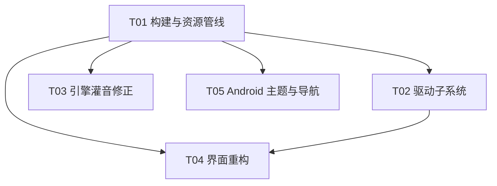

# WO Mic Link 增量开发 —— 架构决策与文件级任务分解

> 作者：高见远（架构师）｜版本：2026-10 增量轮
> 输入：用户本轮需求 + 已实测技术结论 + 现有代码实读（`client/src/*`、`android/app/*`）
> 适用范围：Windows 客户端改造、Android 端主题与导航

---

## 0. 读代码后发现的三个硬事实（决定后续所有设计）

| # | 事实 | 出处 | 影响 |
|---|---|---|---|
| F1 | `client/src/engine.c:22` 用 `IOCTL_WOMIC_FEED 0x222000` 灌音；诊断报告 §9 实测该编号在 2022 驱动（2.1.0.0）上 **51/51 全失败，首错 `ERROR_INVALID_FUNCTION`**。真实协议是 `0x222004 → 0x222008 → 0x222014 → 0x222010 → 0x222001` 握手序列 | `diagnosis.md:315-336` | **当前客户端连上也不出声**，这是 P0 缺口，且**与 UI 框架选型无关** |
| F2 | 官方包内 5 份 INF 中，2022 版有 **NTx86 / NTamd64 / NTARM64** 三套，硬件 ID 均为 `Root\WOMic`；2017 版（`womic_3/4`）才是 `*WOMic` | `diagnostics/attachments/inf-arch-matrix.txt` | "按架构选包"三档**全部有货**，arm64 不是空想 |
| F3 | 三份 2022 `.cat`（`womic.cat`/`womic_1.cat`/`womic_2.cat`）签名链均为 `Microsoft Windows Hardware Compatibility Publisher ← Microsoft Windows Third Party Component CA 2014 ← Microsoft Root Certificate Authority 2010` | 本轮 `openssl pkcs7` 验签 | 是 **WHCP 签名**，不受 2026-04 起"Windows 驱动策略"封杀非 WHCP 驱动的影响（[Microsoft 支持文档](https://support.microsoft.com/en-au/windows/the-windows-driver-policy-ecd2a78c-750c-415d-93f2-e37302ce0443)） |

---

## 1. 关键技术决策

### 1.1 Windows 客户端：改造 C/mingw，还是重写到 .NET / Avalonia / WinUI？

**结论：改造现有 C/mingw 实现。不重写。**（置信度：高）

#### 量化对比

| 维度 | **A. 改造 C/mingw（推荐）** | B. .NET 10 + Avalonia（NativeAOT） | C. WinUI 3 |
|---|---|---|---|
| 产物体积 | **~300–400 KB**（现 81.5 KB + 静态 libopus decoder ~150–200 KB） | **15–31 MB**；参考实现实测 `dotnet publish -r win-x64` ≈ 31 MB，UPX 后 ≈ 9 MB（[peaceshi/Avalonia-NativeAOT-SingleFile](https://github.com/peaceshi/Avalonia-NativeAOT-SingleFile)）；带 Skia+ANGLE 静态库 | 自包含 30–80 MB；用框架包仍需 WindowsAppSDK 运行时 |
| 运行库依赖 | **零**（仅 KERNEL32/USER32/GDI32/SHELL32/UxTheme/WS2_32/msvcrt） | 无（AOT 后），但需静态链接 Skia/ANGLE | WindowsAppSDK 版本耦合 |
| 交叉编译 | **Linux → Windows 已通**（`build.sh`） | NativeAOT 交叉发布需 MSVC 链接器/SDK，**Linux→Windows 链路脆弱** | 需 Windows + VS |
| 观感上限 | 中：GDI+/GDI 手绘可达 Fluent 观感（卡片/圆角/无边框/DPI/双主题已实测），但**无现成控件、无动画系统、无无障碍/触控/IME** | 高：XAML + 70+ 控件 + Fluent/Simple 主题 + 动画 + 无障碍 | 最高：原生 Fluent 2 / Win11 |
| 观感实现成本 | 高（每类控件手写；本项目只用到 8 类：按钮/分段/滑块/开关/卡片/电平表/日志/折叠面板 → **可控**） | 低 | 低 |
| 维护成本 | 中（现 1812 行；**本轮会按模块拆开降到单文件 <400 行**） | 低 | 低 |
| **杀软误报风险** | **低**：普通小 PE、无打包器、无自解压 | **高**：单文件自解压到 `%TEMP%` + 大体积 + NativeAOT 小众特征；再叠 UPX 更糟（UPX 是 AV 高敏特征） | 中 |
| 驱动安装代码量 | C 直调 SetupAPI / Crypt32 / Advapi32，天然契合 | 需 P/Invoke 几十个 Win32 + Crypt32 + SetupAPI 签名 | 同 B |
| 现有资产复用 | **100%**（协议、UI、构建、fake_server 全部可用） | 0%，协议引擎/驱动 IO/界面全部重写 | 0% |

#### 三条决定性理由

1. **体积 + 免安装是本项目的第一约束，也是产品卖点**（81 KB vs 官方客户端 1.7 MB）。上 .NET 会把它变成 20 MB+，直接违背需求；而"现代美观"在本项目里只需 8 类控件，GDI+ 手绘的观感上限**够用**（已实测两套主题、DPI、DWM 圆角）。
2. **杀软误报是用户点名的风险**。.NET 单文件 = 自解压行为 + 大体积 + 稀有运行时特征，再叠加"安装内核驱动"这一高危动作，三重特征叠加会显著抬高启发式命中率。300 KB 的 mingw PE 是最不容易被误报的形态。
3. **真正的缺口与 UI 框架无关**。缺的是：灌音协议没跟上最新逆向结论（F1）、驱动自动安装缺失、单实例未强制、Opus 未内置。重写 UI 不会让这些更快，反而要重付一次协议与驱动 IO 的成本。

#### 对冲措施（把"维护成本"这个唯一劣势压下去）

- 把 `main.c`（1198 行）拆成 `theme / ui_draw / ui_layout / ui_voicemeter / cli` 五个模块，每个 < 400 行；
- 引擎与 UI 已由 `app.h` 的 `EngineStats` 解耦 —— **保留未来换 Avalonia 的余地**：届时只重写 UI 模块，引擎不动；
- **推翻本决策的触发条件**：若后续要求多语言 / 无障碍 / 触控手势 / 系统通知 / 自动更新 / 复杂设置树，手绘成本会失控，届时再上 Avalonia。

> 顺带否掉第三条路：**Tauri / WebView2**（2–5 MB，但引入 WebView2 Runtime 依赖 + HTML/CSS/JS 三层），在"体积小"和"免安装"两项上都不占优，不推荐。

---

### 1.2 驱动自动安装的落地方式

#### 1.2.1 如何检测"驱动是否已安装"

**铁律：不看安装工具的输出**（`devcon` 会先打印 "Device node created" 再选驱动，失败也是这句话 —— `diagnosis.md:170`）。

采用**三级判定**，按成本从低到高：

| 级别 | 手段 | 说明 |
|---|---|---|
| L1（快路径） | `CreateFileW(L"\\\\.\\WOMic")` 成功 | 设备存在且可访问。**注意 F2/§10 E2：这会占用一次门控，必须与业务句柄复用，不能"探测完就关"** |
| L2（权威） | SetupAPI 枚举 `GUID_DEVCLASS_MEDIA`，匹配硬件 ID 含 `WOMic`，读 `DEVPKEY_Device_DriverInfPath` **非空** | 不需提权；这是 `diagnosis.md:172` 验证过的权威判据 |
| L3（辅助） | `C:\Windows\System32\drivers\womic.sys` 落盘 | 防"INF 装了但 SYS 没复制" |

UI 三态：`已就绪`（绿）/ `未安装`（橙，给"安装"按钮）/ `需重启`（黄）。

#### 1.2.2 如何按架构选包

用 **`GetNativeSystemInfo()`**（不是 `IsWow64Process`，后者在 x64 上的 32 位进程会返回 true 造成误判）：

| `PROCESSOR_ARCHITECTURE_*` | 取用的三件套 | INF 段 | SYS 大小 |
|---|---|---|---|
| `AMD64` | `womic_1.{inf,sys,cat}` | `NTamd64` | 51,192 B |
| `ARM64` | `womic_2.{inf,sys,cat}` | `NTARM64` | 53,792 B |
| `INTEL` | `womic.{inf,sys,cat}` | `NTx86` | 43,552 B |

**2017 版（`womic_3/4`，硬件 ID `*WOMic`）一律不用** —— 其灌音协议与已破解的握手序列不匹配。

#### 1.2.3 驱动包从哪来

**内置到 exe，不运行时下载。**

- 三套原始文件合计 ≈ 200 KB；内置时用 deflate 压缩成一个资源块，实测约 110–130 KB，落在 `.rsrc` 段；
- **运行时下载 .sys 是杀软的强特征**（"下载并执行内核驱动"），必须避免；
- 离线可用 —— 用户可能在没有外网的内网环境首次运行。

释放规则（三条都不能违反，否则重现 `0xe0000228` / `0xE000024B` / `0xE0000242`）：
1. 目标目录 `%ProgramData%\MicLink\driver\<arch>\`（不用 `%TEMP%`，前者更像正规软件，且不会被清理工具中途删掉）；
2. **三件套必须成套改回原名 `womic.inf` / `womic.sys` / `womic.cat`** —— CAT 里存的是按文件名索引的哈希，改名不一致就 `0xE000024B`；
3. 装完确认成功后立即删除释放目录（不留散落的 .sys）。

#### 1.2.4 安装流程（提权子进程内）

```
1. 释放三件套 → %ProgramData%\MicLink\driver\<arch>\
2. 信任 catalog 签名者（幂等，失败不致命则继续）
   CryptQueryObject(cat) → 取 signer CERT_CONTEXT
   → CertOpenStore(CERT_SYSTEM_STORE_LOCAL_MACHINE, "TrustedPublisher")
   → CertAddCertificateContextToStore
   （用 crypt32.dll API，不派生 certutil 进程）
3. 创建 root-enumerated devnode（等价于 devcon install，自己实现，不依赖外部工具）
   SetupDiCreateDeviceInfoList(GUID_DEVCLASS_MEDIA)
   → SetupDiCreateDeviceInfo(..., DICD_GENERATE_ID)
   → SetupDiSetDeviceRegistryProperty(SPDRP_HARDWAREID, L"Root\WOMic")
   → SetupDiCallClassInstaller(DIF_REGISTERDEVICE)
4. 绑定驱动
   UpdateDriverForPlugAndPlayDevices(NULL, L"Root\\WOMic", infPath, INSTALLFLAG_FORCE, &reboot)
5. 判定：回到 1.2.1 的 L1/L2/L3，不看任何工具输出
6. 失败兜底：抓取 %windir%\inf\setupapi.dev.log 中本设备的区段，在 UI 展开区展示
```

> 为什么不直接用 `pnputil`：`pnputil /add-driver <inf> /install` **不会创建 root-enumerated devnode**（[Microsoft 官方 devcon install 文档](https://learn.microsoft.com/en-us/windows-hardware/drivers/devtest/devcon-install) 给出的推荐替代是 `devgen /add /bus ROOT /hardwareid <id>` + `pnputil /add-driver /install`），而 `devgen.exe` 不保证随系统自带。自己走 SetupAPI 是唯一能保证"单文件零外部工具"的路。DIFx/DPInst 自 Win10 1607 起已废弃（[DIFx Guidelines](https://learn.microsoft.com/eu-es/windows-hardware/drivers/install/difx-guidelines)），不采用。

#### 1.2.5 提权与 UAC manifest

**主 exe manifest 用 `asInvoker`，需要装驱动时以 `ShellExecuteW("runas", 自身, L"--install-driver")` 重启自身。**

- 平时双击**不弹 UAC**（降低 AV 关注度、体验好）；
- 只有"安装/修复/卸载驱动"这一个动作提权；
- 坑：`runas` 启动的子进程工作目录可能落在 System32，必须用 `GetModuleFileNameW` 定位资源与自身路径。

#### 1.2.6 规避杀软误报（具体动作清单）

| 类别 | 动作 |
|---|---|
| **不做** | 不加 UPX/任何壳；不做自解压包；不运行时下载驱动；不写 Run 自启动；不创建服务；不注入其他进程 |
| **要做** | 嵌入 `VS_VERSION_INFO`（公司名/产品名/描述/版本号）+ 应用图标（`windres` 编进 `.rsrc`）—— 有"发布者信息"的 PE 声誉更好 |
| **要做** | 装驱动前弹 UI 明确告知"即将安装 WO Mic 官方虚拟声卡驱动（微软 WHCP 签名）"，用户可取消 |
| **要做** | 提权路径最小化（仅 `--install-driver`），且该子进程只做安装一件事 |
| **要做** | README + GUI 内附"被拦截怎么办"指引：① 文件属性→解除锁定 ② Defender 排除项 ③ 向 [Microsoft 误报申诉](https://www.microsoft.com/en-us/wdsi/filesubmission) 提交 |
| **要做（预算允许）** | 代码签名：开源项目可申请 Certum Open Source OV（约 €25/年），商业 OV 约 ¥600–1500/年，EV 约 $300–500/年（EV 可立即建立 SmartScreen 声誉，OV 需靠下载量累积） |
| **天然优势** | 驱动本身是 MS WHCP 签名，装驱动这一环不会被驱动策略拦截（F3） |

---

### 1.3 Android 主题方案

#### 组织方式（4 个文件 + 1 个依赖）

```
theme/ThemeMode.kt      enum { SYSTEM, LIGHT, DARK }
theme/AppPalette.kt     sealed interface：Dynamic | Seed(id, displayName, seedColor, paletteStyle)
theme/ColorSchemes.kt   fun buildColorScheme(mode, palette, amoled, darkOverride): ColorScheme
theme/ThemePrefs.kt     SharedPreferences 持久化 + 读取
ui/theme/Theme.kt       WomicTheme(...) 组合点（替换现有 WomicWifiClientTheme）
```

**依赖新增**：`com.materialkolor:material-kolor`（加入 `gradle/libs.versions.toml`）。
理由：不重复造轮子 —— 从 seed 生成完整 M3  tonal palette 是已解决的公共问题，material-kolor 提供 `PaletteStyle.{TonalSpot, Vibrant, Expressive, Neutral, Fidelity, Content, Rainbow, FruitSalad}`，正好对应"活泼 / 低饱和度"两组诉求。

#### 三档配色的具体参数

| 档位 | 实现 | 说明 |
|---|---|---|
| **动态取色**（默认，Android 12+） | `dynamicLightColorScheme(context)` / `dynamicDarkColorScheme(context)` | 现有代码已有，保留；Android 12 以下回退到 Seed 档 |
| **活泼 Vivid** | `PaletteStyle.Vibrant`（或 `Expressive`）+ 种子色预设：`#FF6B35`(橙) / `#6366F1`(靛蓝) / `#10B981`(翠绿) / `#EC4899`(洋红) | 高饱和、强对比 |
| **低饱和 Muted** | `PaletteStyle.Neutral`（或 `TonalSpot`）+ 种子色预设：`#7A8B99`(灰蓝) / `#8C7A6B`(灰褐) / `#6B8E7A`(灰绿) / `#9C8AA5`(藕荷) | 柔和不刺眼 |

外加 **AMOLED 开关**（独立布尔，仅深色下生效）。

#### AMOLED 深色做法（关键细节）

```kotlin
base.copy(
  background            = Color(0xFF000000),
  surface               = Color(0xFF000000),
  surfaceContainerLowest= Color(0xFF000000),
  surfaceContainerLow   = Color(0xFF0A0A0A),
  surfaceContainer      = Color(0xFF121212),
  surfaceContainerHigh  = Color(0xFF1A1A1A),
  surfaceContainerHighest=Color(0xFF242424),
  surfaceVariant        = Color(0xFF141414),   // 不能一起变纯黑，否则卡片边界消失
  // primary / secondary / tertiary 及其 on-* 一律不动 → 对比度天然达标
)
```

四条注意事项：
1. `surfaceVariant` / `surfaceContainer*` **必须保留梯度**，全黑会让卡片与背景不可分辨；
2. `onSurface` / `onSurfaceVariant` 保持原值，WCAG 对比度自动满足；
3. 深色用 tonal elevation，AMOLED 下靠 `surfaceContainer*` 梯度表达层级，不要再加 elevation overlay；
4. 列表滚动到底/顶用 `surfaceContainerLowest`（纯黑），避免"发光边"。

#### 持久化

沿用现有 `SharedPreferences`（`Prefs.kt` 的 `womic_wifi_client_prefs`），**不引入 DataStore** —— 体积与依赖都更省，且已有 `Prefs.verifyDefaults()` 自检套路可复用。新增 4 个键：`theme_mode` / `palette_id` / `amoled` / `contrast`。

---

### 1.4 导航：单界面 vs 横向抽屉

**结论：上 `ModalNavigationDrawer`（横向抽屉），3 个目的地。**

理由：
- 当前功能量：主功能 1 组（启停 / 地址 / 端口 / 音量 / 调试音 / 使用说明）+ 新增**外观设置** + **关于与帮助** = 3 个目的地，已达抽屉阈值；
- 用户明确倾向抽屉；且"外观"页需要**大块配色色板预览**，抽屉目的地页比弹窗更合适；
- Material3 中 `ModalNavigationDrawer` 是手机端"少量目的地 + 全屏内容"的官方推荐形态（永久抽屉是平板/桌面形态）；
- 主界面**内部仍保持全平铺**（状态卡 + 大按钮 + VoiceMeter + 关键设置），符合"功能少则单界面"；抽屉只承载二级目的地。

目的地：`主页` / `外观` / `关于与帮助`。（预留第 4 个 `诊断`，本轮不实现。）

---

## 2. 联网调研结论摘要

| 议题 | 结论 | 来源 |
|---|---|---|
| 驱动静默安装工具选型 | DIFx/DPInst/DifxApp 自 **Win10 1607 起废弃**，官方建议改 `PnPUtil` 或自定义安装器调 `DiInstallDriver` | [Microsoft DIFx Guidelines](https://learn.microsoft.com/eu-es/windows-hardware/drivers/install/difx-guidelines) |
| root 枚举设备节点 | `pnputil /add-driver /install` **不创建** root devnode；官方给 `devcon install` 的替代是 `devgen /add /bus ROOT /hardwareid <id>` + `pnputil /add-driver /install` | [Microsoft DevCon Install](https://learn.microsoft.com/en-us/windows-hardware/drivers/devtest/devcon-install) |
| pnputil 权限 | 绝大多数操作必须**管理员**；`Access is denied`(err 5) 是首要失败原因 | [PnPUtil 用法](https://rottenwifi.com/how-to-install-inf-drivers-with-pnputil-from-command-prompt/) |
| 驱动签名策略（2026） | 2026-04 安全更新起，交叉签名驱动默认不再受信任，需 WHCP 签名；**但本项目三份 .cat 已确认是 WHCP 签名，不受影响** | [Windows Driver Policy](https://support.microsoft.com/en-au/windows/the-windows-driver-policy-ecd2a78c-750c-415d-93f2-e37302ce0443) + 本轮 openssl 验签 |
| .NET 单文件体积 | self-contained 单文件 50–100 MB；+Trim 10–30 MB；**NativeAOT 3–15 MB**；Hello World AOT 在 .NET 10 已降到 **1.05 MB** | [State of Native AOT in .NET 10](https://code.soundaranbu.com/state-of-nativeaot-net10)、[HN 实测](https://news.ycombinator.com/item?id=44814861) |
| Avalonia AOT 实测体积 | 官方模板 App `dotnet publish -r win-x64` ≈ **31 MB**；UPX 后 ≈ **9 MB** | [Avalonia-NativeAOT-SingleFile](https://github.com/peaceshi/Avalonia-NativeAOT-SingleFile) |
| SmartScreen 误报诱因 | 无签名 + 无下载量声誉 + MOTW；PS2EXE/打包器/自解压是典型触发模式；无证书时只能靠累积声誉或提交申诉 | [Grokipedia: SmartScreen](https://grokipedia.com/page/Microsoft_SmartScreen)、[Signing & SmartScreen 实践指南](https://github.com/ForeverToAI/AiPC/blob/main/docs/SIGNING.md) |
| 签名成本 | EV $300–500/年（立即建立声誉）｜OV ¥600–1500/年（需累积）｜Certum 开源 OV ≈ €25/年 | 同上 |
| Compose M3 多主题 + AMOLED | 通行做法：`ThemeMode × Palette(seed/style) × Amoled` 三元组；AMOLED 只替换 `surface/background/surfaceContainer*`，**不动 primary/on-\*** 以保对比度；Palette 生成用 material-kolor 而非手写 | [Grit 主题系统](https://deepwiki.com/shub39/Grit/6.1-material-you-theme-system)、[PCSalt M3 主题指南](https://pcsalt.com/compose/compose-theming-material3) |

---

## 3. 任务分解（有序，可直接交付工程师）

### 依赖图



---

### T01 — 构建与资源管线（P0，无依赖）

**目标**：让"驱动包内置"、"图标与版本资源"、"静态 libopus"三条管线就位，后面三个任务才能落地。

| 文件（相对 `miclink-open/`） | 动作 |
|---|---|
| `client/tools/pack_driver.py` | 新建：读 `womic-recon/all/driver/` 三套 2022 文件 → deflate 压缩 → 生成 `client/src/drvpkg_data.h`（`{arch, inf/sys/cat 字节 + 长度}` 数组） |
| `client/src/drvpkg_data.h` | 新建（生成物，随构建刷新） |
| `client/res/app.rc` | 新建：`VS_VERSION_INFO`（公司名/产品名/版本/描述）+ 图标 + `asInvoker` manifest 声明 |
| `client/res/app.ico` | 新建 |
| `client/build.sh` | 修改：加 `windres` 编资源、加 `-DOPUS_STATIC`、链接 `libopusdec.a`、产出体积与导入表自检 |
| `client/build.bat` | 修改：同 build.sh |
| `android/gradle/libs.versions.toml` | 修改：新增 `material-kolor`、`androidx-navigation-compose`（若未含）、`androidx-datastore`（**不引入**，见 1.3） |
| `android/app/build.gradle.kts` | 修改：新增 material-kolor / navigation-compose 依赖 |

**验收标准**
- `./build.sh` 成功；产物 `build/womic.exe` **< 450 KB**；
- `objdump -p` 导入表**仅**系统 DLL（不得出现 `libgcc`/`libwinpthread`/`vcruntime`）；
- `womic.exe` 右键属性→详细信息能读到产品名与版本号；
- 双击运行**不弹 UAC**；
- `./gradlew :app:assembleDebug` 通过，material-kolor 已解析。

---

### T02 — Windows 驱动子系统：检测 / 安装 / 单实例（P0，依赖 T01）

**目标**：首次运行自动检测驱动，未安装则一键安装；并强制单实例（§10 E2 硬约束）。

| 文件 | 动作 |
|---|---|
| `client/src/drvinst.h` / `drvinst.c` | 新建：`drv_detect()`（三级判定）、`drv_install()`、`drv_uninstall()`、`drv_last_error()`；SetupAPI devnode 创建 + Crypt32 导入 signer 到 TrustedPublisher |
| `client/src/drvpkg.h` / `drvpkg.c` | 新建：`drvpkg_extract(arch, outDir)` —— 从内置资源解压并按原名落地三件套 |
| `client/src/singleinst.h` / `singleinst.c` | 新建：`CreateMutexW` 全局互斥 + 已运行时把命令行转发给已有的实例并退出 |
| `client/src/app.h` | 修改：新增 `DrvState` 枚举、`drv_*` 声明、`--install-driver` 命令常量 |
| `client/src/main.c` | 修改：`WinMain` 早段处理 `--install-driver`（提权子进程路径），否则进单实例检查 → 驱动检测 |
| `client/src/cli.h` / `cli.c` | 新建（本轮先落参数骨架与 `--install-driver` / `--status`，完整 CLI 由 T04 补） |

**实现顺序**
1. `singleinst.c`（最独立，且是 §10 E2 的硬前提）
2. `drvpkg.c`（纯解压，可用 Linux 侧单测验证字节一致）
3. `drvinst.c` 的 `drv_detect()`（先只做检测，界面能显示三态）
4. `drvinst.c` 的 `drv_install()` + main.c 的提权分支

**验收标准**
- 未装驱动的机器：UI 显示"未安装"；点安装 → 弹一次 UAC → 装完 → **L2 判据 `DEVPKEY_Device_DriverInfPath` 非空** 且 `CreateFileW(\\.\WOMic)` 成功；
- 已装驱动的机器：启动时**不重复安装**、不弹 UAC；
- **在 x64 真机跑通一次**；`womic.exe --status` 能输出架构/InfPath/三件套版本；
- 二次运行 exe：不弹窗，已有实例被激活（单实例生效）；
- `setupapi.dev.log` 中本设备区段无 `0xe0000228` / `0xE000024B` / `0xE0000242`。

---

### T03 — 引擎灌音修正 + Opus 内置（P0，依赖 T01）

**目标**：修掉 F1，让"连上就有声音"。

| 文件 | 动作 |
|---|---|
| `client/src/devio.h` / `devio.c` | 新建：封装 `\\.\WOMic` 句柄与握手序列 —— `dev_open()`（**全局唯一一次** CreateFile）→ `ioctl 0x222004` 读 1B key → `0x222008` 发 `key^0x3B`（**只有 1 次机会，失败即放弃**）→ `0x222014` 写 2B 大端容量（默认 `0x1680` = 60ms，可选 `0x0A00`/`0x2D00`）→ `0x222010` 写 1 启动 → `0x222001` 灌 PCM（**恒定返回失败，不得用作判据**）→ `0x222010` 写 0 停止 |
| `client/src/engine.c` | **重写**灌音与生命周期：删掉 `IOCTL_WOMIC_FEED 0x222000`；`eng_device_available()` **不再独立开句柄**（改用已打开句柄或 SetupAPI，见 R2）；全程复用 `devio` 的单一句柄；输出强制 **48 kHz / 16bit / 单声道**；按 20 ms 节奏推 1920 B；帧统计与电平不依赖 IOCTL 返回码 |
| `client/src/opusdec.h` / `opusdec.c` | 新建：优先静态链接（`-DOPUS_STATIC`），缺失时回退 `LoadLibrary("opus.dll")` 动态加载；不再让"没 opus.dll 就没声音" |
| `client/src/app.h` | 修改：`EngineStats` 增 `buffer_ms`、`dev_handshake_ok`、`opus_src`（static/dll/none） |
| `client/tools/fake_server.py` | 修改：补一条"发真实 Opus 编码 1 kHz 正弦"的模式，便于无手机端到端验证 |

**实现顺序**
1. `devio.c`（纯 IOCTL，可用独立探针程序验证）
2. `opusdec.c`（静态优先、动态回退）
3. `engine.c` 重写（把 devio + opusdec 接进去）

**验收标准**
- `fake_server.py` 发 1 kHz Opus 流 → 客户端解码并灌入；用**采集端 RMS 判频**（唯一可用的健康自检，§10.4 #6）得到 **主峰 ≈ 1000 Hz、rms 显著非零、snr > 100**（对标 `diagnosis.md:419` 的 rms=8485 / snr=735）；
- 喂 44.1 kHz 时**不得**出现（驱动不重采样会变调）—— 代码层保证常量 48000；
- 断开重连 5 次，每次都能重新握手成功（验证"每次 open 清零门控"被正确处理）；
- 无 `opus.dll` 时仍能出声（静态解码生效）；
- 未装驱动时不崩，UI 明确提示"未安装虚拟麦克风"。

---

### T04 — Windows 单界面重构 + VoiceMeter + 命令行说明书（P1，依赖 T01、T02）

**目标**：单一主界面平铺所有功能（可折叠二级），VoiceMeter 控件，GUI 内命令行说明书，完整 CLI。

| 文件 | 动作 |
|---|---|
| `client/src/theme.h` / `theme.c` | 新建：从 main.c 抽出 `Theme` / `theme_apply()` / `apply_theme()`；新增折叠面板与 VoiceMeter 用到的色号 |
| `client/src/ui_draw.h` / `ui_draw.c` | 新建：绘制原语（`fill_round`/`stroke_round`/`bg_gradient`/`text_at`/`icon_draw`）+ 通用控件（卡片 / 按钮 / 分段 / 滑块 / 开关 / **折叠面板**） |
| `client/src/ui_layout.h` / `ui_layout.c` | 新建：单列纵向卡片流布局，支持卡片展开/收起后的重排与滚动 |
| `client/src/ui_voicemeter.h` / `ui_voicemeter.c` | 新建：VoiceMeter 控件 |
| `client/src/ui_help.h` / `ui_help.c` | 新建："命令行使用说明书"窗口（自绘滚动文本，内容来自内置字符串表） |
| `client/src/cli.c` | 修改：补全参数解析 + `AttachConsole(ATTACH_PARENT_PROCESS)` 输出方案 |
| `client/src/main.c` | **重写为薄壳**：窗口创建 + 事件分发 + 模块装配（从 1198 行降到 < 300 行） |
| `client/src/app.h` | 修改：新增 UI 模块接口 |

**VoiceMeter 控件规格**
- 输入：`EngineStats.level`(RMS 0..1) / `peak` / `db` / `state` / `frames`
- 呈现：横向 32–40 段条（阈值 `<0.66` accent / `<0.86` warn / `≥0.86` err）+ 峰值保持线 + dBFS 数值（等宽字体）+ 峰值百分比 + 状态徽标（`无信号` / `正常` / `过载`）
- 动态：attack 快（现有 0.35 系数）、release 慢（每秒 ×0.72）；连续 N 帧低于静音阈值 → 显示"无信号"；`ST_STREAMING` 时状态点呼吸
- 性能：仅在 `running` 时以 16 ms 定时器重绘，空闲不占 CPU

**CLI 规格**
```
womic.exe [--host IP] [--port 8125] [--rate 48000|16000|8000]
          [--buffer 26|60|120] [--gain 0..200]
          [--connect] [--status] [--install-driver] [--uninstall-driver]
          [--theme dark|light] [--light] [--help] [--version]
退出码：0 成功 / 1 参数错误 / 2 连接失败 / 3 驱动不可用 / 4 驱动安装失败
```
- `-mwindows` 无控制台：进入时若带 CLI 参数或父进程有控制台 → `AttachConsole(ATTACH_PARENT_PROCESS)` + `freopen("CONOUT$")`，否则 `AllocConsole()`；
- GUI 内「命令行使用说明书」按钮 → 弹出 `ui_help` 窗口，列出全部参数、示例、退出码。

**验收标准**
- 单一窗口内可见：连接区 / 驱动状态卡 / VoiceMeter；音频参数、统计、事件日志**默认收起**，点击展开；
- 展开/收起后布局不重叠、不残留（DPI 125%/150% 各验一遍）；
- 连接后 VoiceMeter 实时跳动，断线后 2 s 内回落并转"无信号"；
- `--help` 在 cmd 与 PowerShell 中均正常输出；双击 exe 不闪黑窗；
- GUI 说明书按钮能打开，内容与 `--help` 一致；
- 产物体积仍 **< 450 KB**。

---

### T05 — Android：主题系统 + 抽屉导航（P1，依赖 T01）

**目标**：多套配色（活泼 / 低饱和 / 动态取色）+ AMOLED 纯黑 + 横向抽屉导航。

| 文件（相对 `android/app/src/main/java/com/miclink/open/`） | 动作 |
|---|---|
| `theme/ThemeMode.kt` | 新建：`enum class ThemeMode { SYSTEM, LIGHT, DARK }` |
| `theme/AppPalette.kt` | 新建：`sealed interface AppPalette`：`Dynamic` / `Seed(id, labelRes, seedColor, style)`；预置 4 活泼 + 4 低饱和种子色 |
| `theme/ColorSchemes.kt` | 新建：`buildColorScheme(mode, palette, amoled, isDark)`：动态取色 / material-kolor 生成 / AMOLED 覆写 |
| `theme/ThemePrefs.kt` | 新建：4 键持久化（复用现有 SharedPreferences 文件）+ 默认值自检（对齐 `Prefs.verifyDefaults()` 套路） |
| `ui/theme/Theme.kt` | 新建：`WomicTheme(mode, palette, amoled, content)`，**替换** `MainActivity.kt` 里的 `WomicWifiClientTheme` |
| `ui/navigation/AppNav.kt` | 新建：`ModalNavigationDrawer` + `NavHost`（主页 / 外观 / 关于与帮助） |
| `ui/screen/HomeScreen.kt` | 新建：从 `MainActivity.kt` 搬出 `MainScreen` / `StatusCard` / `StatItem` |
| `ui/screen/AppearanceScreen.kt` | 新建：主题模式单选 + 配色色板（带实时预览）+ AMOLED 开关 |
| `ui/screen/AboutScreen.kt` | 新建：使用说明 / 协议说明 / 版本 / 开源许可 |
| `ui/component/VoiceMeter.kt` | 新建：把现有 `LevelBar` 升级 —— RMS/Peak 双条 + dB 数值 + 状态徽标 + 平滑衰减 |
| `MainActivity.kt` | 修改：改用 `WomicTheme` + `AppNav`；删除内联主题与 `MainScreen` |
| `MainViewModel.kt` | 修改：新增 `ThemeState` 与 `onTheme*Changed()` |
| `Prefs.kt` | 修改：委托主题字段给 `ThemePrefs.kt` |

**验收标准**
- 8 套自定义配色（4 活泼 + 4 低饱和）× 明暗 + 动态取色，切换即时生效，无闪烁；
- AMOLED 开启后 `surface == background == #000000`，卡片仍可分辨（`surfaceContainer*` 有梯度），`onSurface` 对比度达 WCAG AA；
- 重启 App 主题设置保持；
- 抽屉能从边缘滑出，三个目的地切换正常，返回键先关抽屉；
- Android 12+ 默认走动态取色，Android 11 及以下自动回退到 Seed 档且不崩；
- `./gradlew :app:assembleDebug` 与 `:core:test` 全绿。

---

## 4. 风险与待明确

### P0（阻塞上线）

| ID | 风险 | 说明与应对 |
|---|---|---|
| **R1** | **现有灌音 IOCTL 是错的**（`0x222000`，实测 51/51 失败） | 已确认（F1）。T03 修。**这是"连上了却没声音"的直接原因** |
| **R2** | **门控是全局的，任何新 `CreateFile` 都清零**；且握手失败只给 1 次机会 | 现有 `eng_start()` 里的 `eng_device_available()` 会额外开一次句柄 —— 必须改为复用同一句柄或用 SetupAPI 判定，**不得"探测完就关、业务再开"**。T03 验收"重连 5 次"覆盖此点 |
| **R3** | **普通交互会话下能否灌音，尚未验证** | §9/§10 的所有灌音实验都在 **SYSTEM / Session 0** 下完成。"采集需 SYSTEM"是 WASAPI 侧的限制，**灌音（DeviceIoControl）是否也需要提权未验证**。若需要 → 用户体验与设计都要改（常驻提权或改走服务）。**建议本轮第一个验证动作就是它**：在普通桌面会话跑 `CreateFile(\\.\WOMic)` + `0x222004` 并读回 1 字节 |

### P1

| ID | 风险 | 应对 |
|---|---|---|
| R4 | UAC 提权：非管理员账户装不了驱动；企业管控机器可能禁 runas | 明确错误提示 + GUI 内"手动安装说明"（`pnputil` 命令行三步骤） |
| R5 | 杀软误报（未签名 exe + 装驱动行为） | 见 1.2.6 全清单；至少把"申诉 + 排除项"指引写进 README 与 GUI；预算允许上 OV/EV 签名 |
| R6 | 2026-04 "Windows 驱动策略"封杀非 WHCP 驱动 | **已核查：三份 .cat 均为 WHCP 签名（F3），不受影响**。需在 README 记录该结论并持续跟踪策略演进 |
| R7 | ARM64 未经真机验证 | 官方包有 NTARM64 套件且同为 WHCP 签名，理论上可行；标为"未实证"，T02 验收只要求 x64 真机 |
| **R8** | **`womic.sys` 再分发的法律合规** | `NOTICE.md` 目前只声明了 MS 示例/libopus/speexdsp/soxr，**没有**第三方已签名驱动的分发条款。**待明确**：WO Mic 官方 EULA 是否允许再分发？若否 → 改为"引导用户从官方渠道获取驱动包"或"运行时从官方 URL 下载"（后者会抬高 AV 风险）。**这一条必须由主理人拍板，会影响 T01/T02 的实现形态** |

### P2

| ID | 风险 | 应对 |
|---|---|---|
| R9 | 单实例遗漏 | 进程互斥 + 内部单一句柄双保险（T02 + T03 各覆盖一层） |
| R10 | `-mwindows` + CLI 输出 | `AttachConsole` 方案；不稳则退化为额外产出 `womic-cli.exe`（控制台子系统），体积翻倍但也就 2×300 KB |
| R11 | 静态链接 libopus 使体积从 81 KB → ~300 KB | 已权衡：换"单文件必然出声"，值得。构建时只编 decoder（关 encoder）以压体积 |
| R12 | `material-kolor` 与 `composeBom 2026.09` 的兼容性未验 | T01 验收里加一条"能解析且编译通过"；不兼容则回退手写 `ColorScheme`（工作量 +1 天） |
| R13 | 客户端界面从未在真机 Windows 验证过（只在 wine） | T04 验收要求真机 125%/150% DPI 各验一遍 |
| R14 | 与**官方** Android app 的互通从未实测（只跑过自研两端） | 不阻塞本轮，但应排进后续验证清单 |

---

## 5. 需要主理人拍板的问题

1. **R8**：`womic.sys`（第三方已签名二进制）能否随我们的 exe 再分发？这决定 T01 是"内置资源"还是"运行时下载/引导用户自备"。
2. **R3**：能否安排一次"普通交互会话下灌音"的真机验证？这是本轮最大的技术不确定项，建议**优先于所有开发任务**执行（半天可出结论）。
3. **签名预算**：是否采购代码签名证书（OV ≈ ¥600–1500/年，Certum 开源 OV ≈ €25/年，EV ≈ $300–500/年）？直接决定杀软误报风险等级。
4. **门槛确认**：若 R3 验证结果是"灌音必须提权"，是否接受客户端常驻提权（每次启动弹 UAC）？这会改变 T02 的形态。
